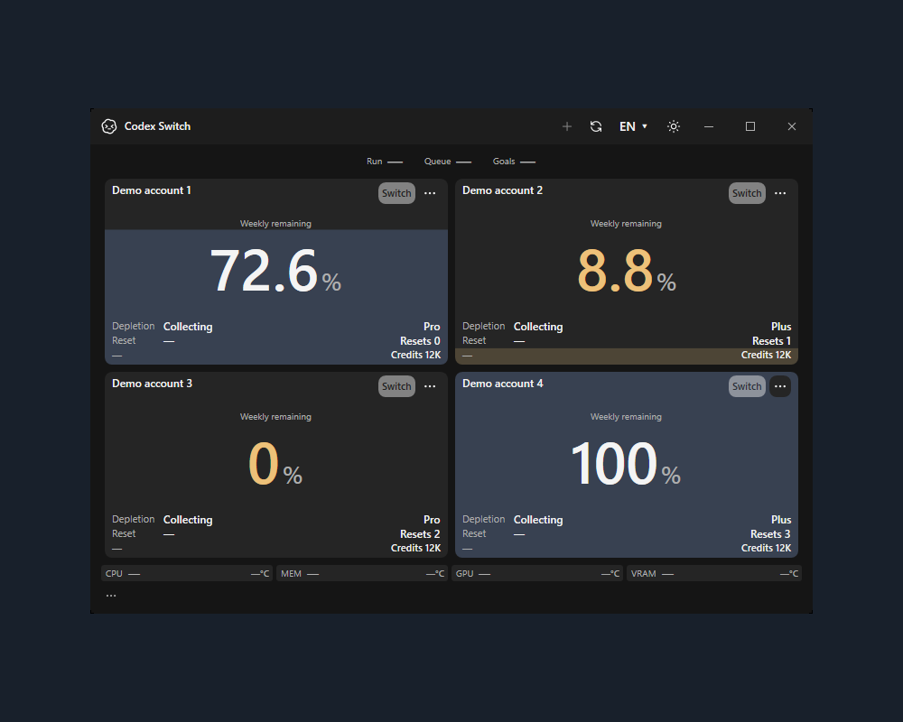

<h1 align="center">Codex Switch</h1>

Switch Codex accounts manually, automatically resume eligible unfinished local chats, and see the remaining quota before choosing your next account. **1.40.2 — Windows, macOS and Linux preview.**

[English](README.md) / [한국어](docs/README.ko.md) / [日本語](docs/README.ja.md) / [简体中文](docs/README.zh-CN.md)

## Download

Complete packages include the .NET runtime; no source build or .NET installation is needed. Keep the entire extracted folder or app bundle.

| Platform | Download |
| --- | --- |
| Windows x64 | [ZIP](https://github.com/Gaebabi/codex-switch/releases/download/v1.40.2/CodexSwitch-v1.40.2-win-x64.zip) |
| macOS15+ Apple Silicon | [ZIP](https://github.com/Gaebabi/codex-switch/releases/download/v1.40.2/CodexSwitch-v1.40.2-osx-arm64.zip) |
| macOS15+ Intel | [ZIP](https://github.com/Gaebabi/codex-switch/releases/download/v1.40.2/CodexSwitch-v1.40.2-osx-x64.zip) |
| Linux x64 **preview** | [DEB](https://github.com/Gaebabi/codex-switch/releases/download/v1.40.2/CodexSwitch-v1.40.2-preview-linux-x64.deb) / [RPM](https://github.com/Gaebabi/codex-switch/releases/download/v1.40.2/CodexSwitch-v1.40.2-preview-linux-x64.rpm) / [tar.gz](https://github.com/Gaebabi/codex-switch/releases/download/v1.40.2/CodexSwitch-v1.40.2-preview-linux-x64.tar.gz) |
| Linux ARM64 **preview** | [DEB](https://github.com/Gaebabi/codex-switch/releases/download/v1.40.2/CodexSwitch-v1.40.2-preview-linux-arm64.deb) / [RPM](https://github.com/Gaebabi/codex-switch/releases/download/v1.40.2/CodexSwitch-v1.40.2-preview-linux-arm64.rpm) / [tar.gz](https://github.com/Gaebabi/codex-switch/releases/download/v1.40.2/CodexSwitch-v1.40.2-preview-linux-arm64.tar.gz) |

[Release notes and SHA256 checksums](https://github.com/Gaebabi/codex-switch/releases/tag/v1.40.2). Windows/Linux packages are unsigned. Mac bundles are ad-hoc signed and **not Apple-notarized**; follow [Mac setup](docs/MACOS.md).

Linux is an integration preview. Native storage, installed UI and package tests are distinct from supported account handoff and full desktop acceptance. Desktop integration requires approved OpenAI Linux client26.1007.71326, an existing file credential policy and X11/XWayland; newer clients require review. CLI-only mode needs an explicit executable checksum and does not resume desktop chats. [Requirements and limits](docs/development/LINUX.md) / [Linux installation](docs/development/LINUX_PACKAGES.md)

## Get started

1. Windows: run `CodexSwitch.exe`. Mac: run `Install.command`, then open the installed **Codex Switch.app**. Linux: install a complete preview package and configure a supported Secret Service provider. [Installation](docs/INSTALL.md)
2. Select **+** for official browser sign-in. If the previous account is automatically selected, use a separate browser profile/private window for the next login. On Windows, right-click **↻** to import the current Codex login.
3. Compare the cards and select **Switch**. **Account switching always requires your click; there is no automatic rotation.** On Linux, use the app's **Start Codex** action before working.

## Features

- **Manual switch, automatic continuation:** back up the current login and verify date-prefixed chat names, normally close Codex, apply the selected account, reopen the same chat IDs/folders/models/permissions, and send one **Continue** to eligible idle unfinished chats. Running or completed work is left alone.
- **Recover interrupted handoffs:** encrypted checkpoints retain progress. **Resume chats** continues pending work; uncertain sends are never automatically repeated. Naming/shutdown failures stop the login change. Windows waits for child processes so one Switch click can finish the flow. [Switching details](docs/SWITCHING.md)
- **Quota and history:** remaining usage, resets, plans, subscription expiry, reset allowances, credits and consumption forecasts. Open **History** in an account's **...** menu. Card dates use your local time zone; the shared history view explicitly labels its KST axes. Expiry within72hours and reset within48hours use warning colors.
- **Local status and resources:** running/queued/goal counts, resource history and disk space. Windows shows independently colored resource/disk temperatures when supported sensors exist; missing values stay unknown. Linux resource telemetry is currently unavailable. [Sensor support](docs/TEMPERATURES.md)
- **Always-on refresh:** account reads every60seconds, with **↻** or **F5** for an immediate refresh. If startup fails while the keyring/client is unavailable, the same schedule retries initialization automatically after it becomes available.
- **Nine UI languages and local JSON language packs:** English, Korean, Japanese, Simplified/Traditional Chinese, Spanish, French, German and Brazilian Portuguese, with English fallback. Icon theme actions, dark/light themes and shared scrollbars keep compact windows usable. [Translation guide](docs/LOCALIZATION.md)

**Switching restarts Codex** and may affect CLI/IDE clients sharing the login. Remaining Linux authenticated cross-account/continuation and broader desktop/accessibility criteria are tracked in [the support roadmap](docs/PLATFORM_SUPPORT_PLAN.md).

## Actual app screenshots

Actual application titlebars/controls are preserved on a solid background. Captions and source/runtime/hash receipts distinguish fictional UI inputs, ordinary Linux execution and authenticated acceptance. [Current gallery](docs/media/release-1.40.2/README.md)

**MacBook screenshot:** reserved for the maintainer's real-device capture.
<!-- MacBook screenshot slot: add docs/media/release-1.40.2/macbook.png and its privacy/provenance receipt, then embed here. Never substitute a different OS image or mockup. -->

## Contribute

[Contributing](CONTRIBUTING.md) / [Security](SECURITY.md) / [Architecture](docs/ARCHITECTURE.md) / [CI](docs/CI.md) / [Operations](docs/development/OPERATIONS.md) / [Evidence](docs/evidence/README.md) / [Forecasts](docs/FORECAST.md)

Independent open-source software, not an official OpenAI product. Credentials stay in a local encrypted vault. [MIT](LICENSE) / [Asset notices](licenses/Burn0Assets.LICENSE.txt)
