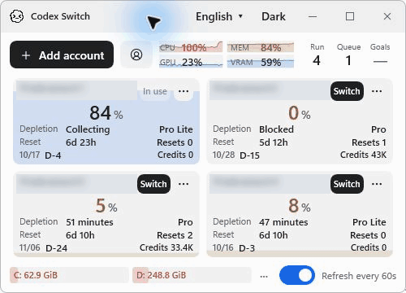
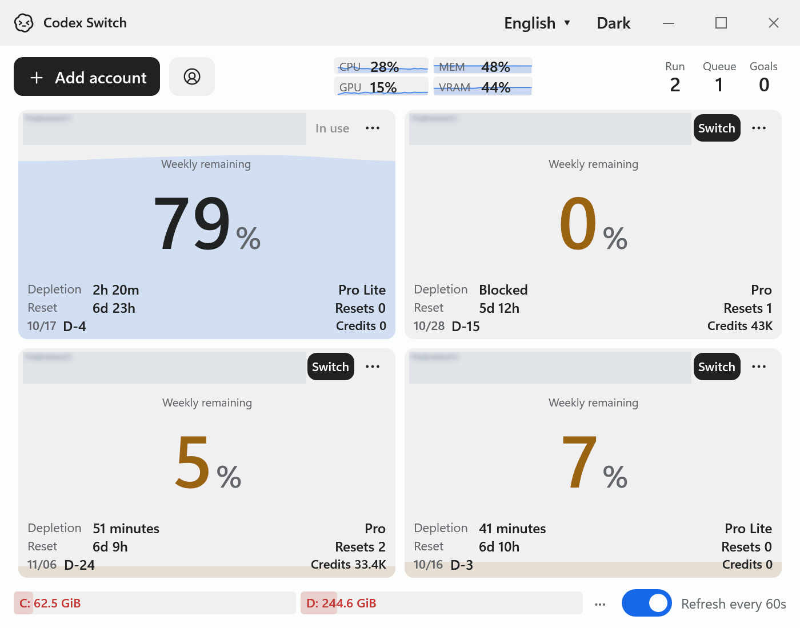
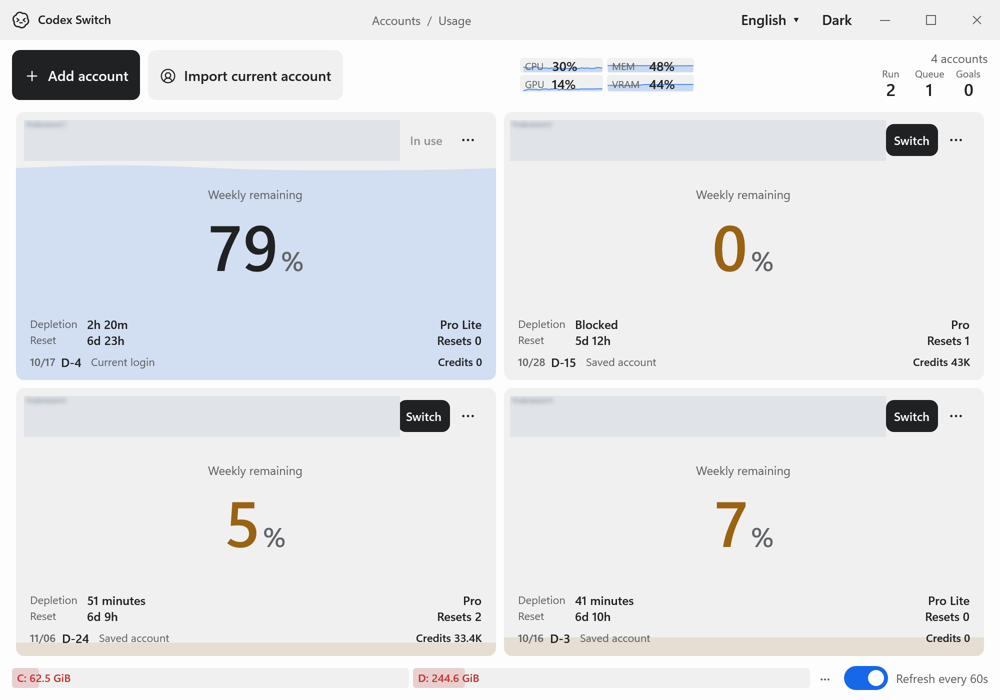

<div align="center">

# Codex Switch

**Switch Codex accounts. Pick your next account with its real quota in view.**

[English](README.md) · [한국어](docs/README.ko.md) · [日本語](docs/README.ja.md) · [简体中文](docs/README.zh-CN.md)


[](LICENSE)

</div>

A local Windows and macOS utility for switching between your Codex accounts, backing up the current login and handing local chats back to the desktop. Live quota gauges help you choose which account to use next.

Independent community software; not affiliated with or endorsed by OpenAI. Source version **1.26.0**. English is the default; the app also supports Korean and preserves your saved language choice.



## Account switching comes first

- **Register and switch accounts:** browser sign-in, import your current Codex login, and a **Switch** action on every inactive account.
- **Keep local chats together:** save active root-chat names with a date suffix, normally quit Codex, apply the selected account, relaunch and reopen the same chat IDs. Eligible idle continuations receive one **Continue**.
- **Choose with real numbers:** reported remaining quota, reset deadlines, plan, reset credits, credit balance and measured usage history. Depletion forecasts are estimates conditional on continued recent usage.
- **See local activity:** running chats, queued messages and active goals; CPU, memory, GPU/VRAM trends and configurable drive free space.
- **Keep it small:** responsive account cards, light/dark themes, tray access on Windows and a quota menu-bar indicator on Mac.

Switching intentionally restarts Codex and affects other CLI/IDE clients sharing the same authentication file. Read [how switching works](docs/SWITCHING.md), including chat renaming and resumption behavior.

## One utility, three window sizes

These are live recordings of the maintainer's everyday Windows session, captured with **Codex Switch 1.26**. Quota values are not staged. Account identity regions are permanently overwritten before a generic blurred placeholder is added; the original name pixels are absent from every exported frame.

| Compact | Standard | Large |
| --- | --- | --- |
| [500 × 360](docs/media/compact.gif) | [699 × 543](docs/media/standard.gif) | [1007 × 708](docs/media/large.gif) |

<details><summary>Standard window</summary>



</details>
<details><summary>Large window</summary>



</details>

The recordings show the live dashboard and responsive layout. They do not show a real account switch or prove chat resumption; recording does not stop Codex or change the active account. Only Windows footage is included.

## Build and run

Install the **.NET 8 SDK or later** and Codex desktop/CLI. Packaged builds are self-contained. No GitHub Release or automatic updater is configured yet.

### Windows x64

```powershell
git clone https://github.com/Gaebabi/codex-switch.git
cd codex-switch
.\scripts\build.ps1 -Verify
.\artifacts\win-x64\CodexSwitch.exe
```

Keep the **entire `artifacts/win-x64` folder** together. Copying only the EXE will not work.

### macOS

```bash
git clone https://github.com/Gaebabi/codex-switch.git
cd codex-switch
bash scripts/build-macos.sh osx-arm64 # Apple Silicon
bash scripts/build-macos.sh osx-x64   # Intel
```

The ZIP contains **Codex Switch.app** and **Install.command**. The installer validates a staged app before replacing an existing installation and preserves a backup. Local builds use ad-hoc signing; Developer ID notarization is not configured. Follow [Mac instructions](docs/MACOS.md).

Earlier Apple Silicon native storage/resource/layout checks passed. Real Mac sign-in, account switching/chat resumption, renamed installation and Intel-device acceptance remain separate. A Windows cross-build does not prove Mac runtime behavior.

## Everyday workflow

1. Select **Add account** to sign in through your browser, or use the account icon beside it to import the current Codex login.
2. Compare the account cards. The active account is labeled **In use**. Use quota selectors to inspect available windows.
3. Choose **Switch** on the account you want next. The utility backs up and hands off local chats as described in [switch behavior](docs/SWITCHING.md).
4. Refresh with **F5** or the tray. Automatic reads run every 60 seconds. Open **History** from an account's `···` menu; configure local drives from the footer's `···` menu.

Change language or appearance from the title bar. Mac also supports **⌘R** to refresh, **⌘W** to hide and **⌘Q** to quit. Closing keeps tray/menu-bar access available.

## Local credentials, explicit boundaries

Windows uses current-user **DPAPI**. Mac uses **AES-GCM with a Keychain-held key** and private filesystem permissions. Existing data remains in `CodexAccountDesk` directories so the rename preserves accounts and settings.

Inactive-account reads use isolated local Codex homes. There is no project-operated account server or analytics endpoint. Credentials, vaults, local databases and raw recordings are excluded from this repository. See [security and privacy](SECURITY.md).

Codex app-server and local desktop protocols can change. Missing/unsupported data appears as **—**, never an invented zero. Activity counts cover local desktop root chats, not remote/cloud work or standalone CLI turns, and cannot be attributed to accounts. GPU metrics depend on platform/driver support.

## Documentation and contributions

- [Switching and chat handoff](docs/SWITCHING.md)
- [Conditional quota forecasts](docs/FORECAST.md)
- [Mac setup](docs/MACOS.md)
- [Contributing](CONTRIBUTING.md) · [Security](SECURITY.md)
- [Media provenance and redaction](docs/media/README.md)
- [Reddit post draft](docs/REDDIT.md)

MIT licensed. Retained theme/icon notices: [Burn0Assets.LICENSE.txt](Burn0Assets.LICENSE.txt). English, Korean, Japanese and Chinese documentation are included; app UI translations currently cover **English and Korean**.
