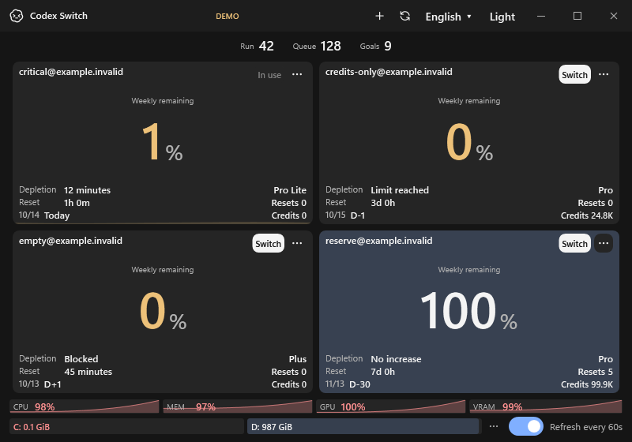

# Codex Switch

快速切换 Codex 账号，先看清下一个账号的剩余额度。**Windows / macOS / 1.27.6**

[English](../README.md) / [한국어](README.ko.md) / [日本語](README.ja.md) / 简体中文

*虚构账号和模拟数据：剩余额度0～100%、运行42项、队列128项、资源负载97～100%。画面使用当前Windows UI渲染。*

## 开始使用

1. Windows 完整解压后运行 `CodexSwitch.exe`。Mac 运行 `Install.command` 安装，再打开 **Codex Switch.app**。[构建与安装](INSTALL.md)
2. 点击标题栏的 **+** 添加账号。Windows 可右键点击 **↻** 导入当前登录。
3. 比较剩余额度并点击 **Switch**。每60秒自动刷新，也可点击 **↻** 或按 **F5** 立即刷新。

请保留完整的程序包。运行包无需安装 .NET；源码构建需要 .NET 8 SDK 和已安装的 Codex 应用/CLI。

## 一眼查看

- 剩余额度、重置倒计时、套餐、订阅结束日期、重置次数与积分余额
- 使用记录和基于记录的耗尽预测。账号的 **...** 菜单中可打开 **History**。
- 本地运行/队列/目标数量、资源趋势和磁盘剩余空间。悬停在仪表上可查看详情。

UI支持英语和韩语；日语和中文仅用于文档翻译。语言与浅色/深色主题可在标题栏切换。

**切换会重启 Codex**并打开原来的本地聊天，也可能影响使用相同登录的 CLI/IDE。[切换详情](SWITCHING.md)

[Mac](MACOS.md) / [预测](FORECAST.md) / [安全](../SECURITY.md) / [开发](../CONTRIBUTING.md)

仓库为private，公开分发已暂停。本项目不是OpenAI官方产品。认证信息在本地加密保存。[MIT](../LICENSE)
