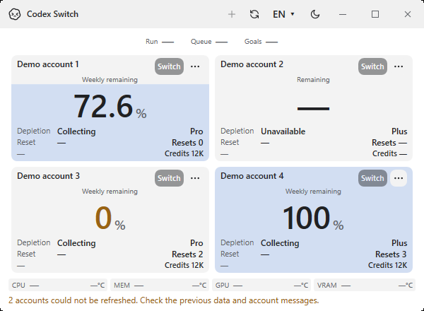
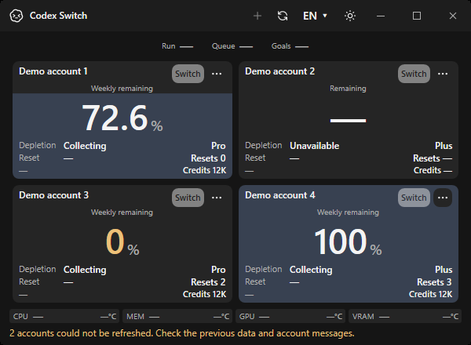
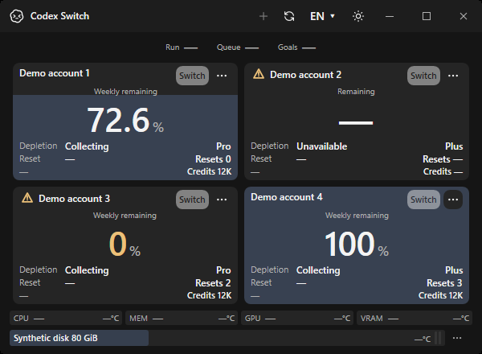
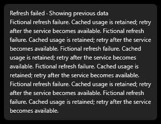
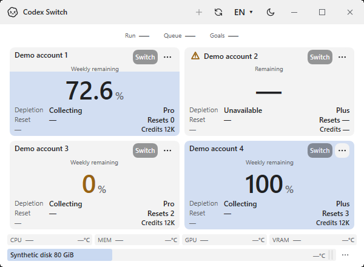

# Windows account warnings and persistent resource rows

[Issue99](https://github.com/Gaebabi/codex-switch/issues/99) / source1.41.1. Published1.40.7 is unchanged. These are actual native Windows x64 app/popup captures with fictional account/disk input, not the owner's attached personal screenshot.

## Same-input before and after

| Before: refresh errors replace disk readings | After: warnings stay beside the affected accounts |
| --- | --- |
|  |  |
|  |  |

**Windows x64 ·600×440 · identical fictional input:** two accounts fail, including one without cached usage and one with cached usage. The original app replaces the disk row with the aggregate warning. The corrected app retains CPU/memory/GPU/VRAM and disk rows, and shows a small vector warning beside only those account names. Cached values and ordinary account actions remain intact. The real application titlebar and pixels are captured together; no desktop-root image, synthetic frame or owner screen is used.

## Minimum size and explanation

| Original500×360 | Corrected500×360 |
| --- | --- |
|  |  |

**Actual minimum-size Windows app:** errors retain their account context and both monitor rows remain visible. Full error text is available through the warning action even when the account name is trimmed.

**Actual popup HWND:** hover opens the explanation; click holds the same themed popup after the pointer leaves. Long fictional text wraps. Escape, focus/window loss and owner removal close it. The default tooltip service does not compete for this warning control. Its accessible name identifies the account and its full explanation is exposed to assistive technology. No real error, account, credential or transcript is pictured.

**Global operation warning:** initialization/switch errors without a single account context retain a separate row below the monitors. They do not replace disk readings.

## Provenance and limits

Capture source `d376f0cd3751e5f0f11c2c05691fd52f72f0fcb2`, [native Windows CI39044029251](https://github.com/Gaebabi/codex-switch/actions/runs/39044029251). The source1.41.0 baseline is a pinned archive of main `9d7b8ec57c1a1008e5dafff527ad76ffa29fd19f`. Only diagnostic hosting is added to supply the same fictional input; SHA256 of all five original production UI files stays identical to their Git blobs. Eight baseline observations reproduce absent warning controls and hidden disks. [Before images/source/hash receipt](before/evidence.json).

The corrected source1.41.1 passes42 native UI assertions for affected/healthy cards, account-relative icon bounds, shared button theme, accessible names/details, min-size footer bounds, hover/leave/click pinning, wrapping, Escape, refresh removal and separate global status. [After images/checks/hash receipt](after/evidence.json). All twelve original native images are retained with unchanged RGB pixels and absent metadata. English fictional input only; nine existing language catalogues are structurally validated separately. This is Windows UI proof, not account authentication, native sensor or Linux/macOS acceptance.

All six exact-head checks, final artifact inspection, author COMMENT review, expected-head merge and private package staging are recorded in issue99's linked PR. Current account/sensor processes are retained; the private complete build applies on the next ordinary app restart. Author review is not independent approval. [Behavior and delivery contract](../../development/ACCOUNT_WARNINGS.md).
