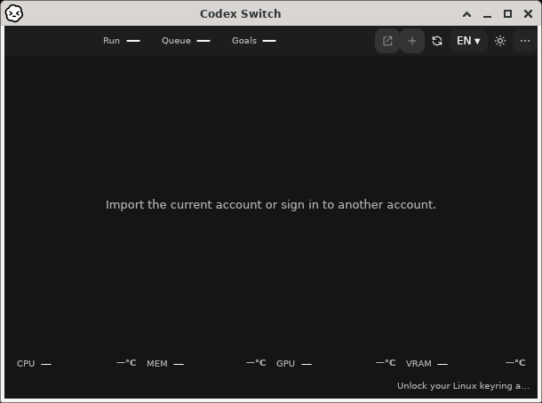
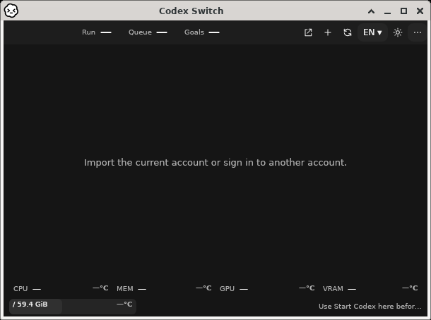

# Automatic recovery after native keyring unlock

Issue81 / [PR82](https://github.com/Gaebabi/codex-switch/pull/82). Source1.40.2 starts the shared desktop's existing clock with the ordinary window, before account initialization. Its60-second scheduled action uses the same guarded initialization/refresh path as the normal Refresh action. Opening with a locked keyring can therefore recover after unlock without pressing Refresh. Account actions still require successful initialization; synthetic capture windows do not start this clock. Vault/key/provider/file identities, strict errors and credential policies are unchanged.

| Before: old application remains unavailable after unlock | After: same corrected window automatically initializes |
| --- | --- |
|  |  |

[Corrected application's initial locked frame](locked.png) also precedes the after frame in the same native process/window. The before/after titlebars are real Xfce WM frames bound to the original app PID/XID/direct parent. Only the program window is captured; no personal desktop, cursor, credentials or real account data appears. PNG metadata is absent and all exported images were visually inspected.

## What was verified

The existing pinned disposable Linux desktop image runs the ordinary per-user installer and native application. Its actual GNOME Keyring is locked before launch. After the unavailable window is captured, the provider is unlocked with an ephemeral test-only password. No keyboard, pointer, fixture API or successful service response is sent to the application to cause recovery. The old application fails the85-second post-unlock deadline; its shared window source is byte-identical to that of the published1.40.1 source120d61c. The corrected application's existing60-second timer creates its encrypted empty vault, renders configured volume/status and enables its controls in the same native window. [Sanitized source, scope, checks and PNG hashes](evidence.json).

The corrected locked/after frames now come from the actual current-source native x64 CI candidate and contracts. Its complete ordinary Xfce session passes53 checks, including real keyring lock/unlock and same-window automatic initialization without app input. [Sanitized native source/check/image receipt](native-session.json). The earlier private Windows cross-publish confirmation and older image-contract scope remain separately identified in the combined receipt. Native Linux x64/ARM64 CI covers current provider/client/package gates; this Xfce userspace session does not establish booted GNOME/KDE/Wayland/ARM64 desktop or accessibility support.

## Separate owner-authenticated acceptance

The owner confirmed that the updated app displayed both preserved accounts without pressing Refresh. The owner then clicked the other real account's **Switch** once and confirmed Codex opened. Fifteen production storage/native-policy/identity/usage checks verify the other canonical account, exact previous-login backup, automatically launched approved desktop and cleared no-chat handoff checkpoint. Both original encrypted accounts reopen through the existing native keyring, and read-only verification preserves canonical credential bytes. [Identifier-free receipt](owner-account-verification.json).

With that managed native Codex running, the owner clicked the other account's **Switch** once more. The original process exited, the other real account was applied and one approved replacement launched automatically. Sixteen production checks include the actual original PID/start identity and normal shutdown/relaunch result, exact previous-login backup and cleared no-chat checkpoint. [Separate identifier-free running-client receipt](owner-running-switch-verification.json). The two ordinary owner clicks returned the active identity to the first account; neither action was automated through a fixture or UI driver.

This authenticated case is separate from the empty-home screenshots. No owner account, authentication, token, private path or personal-screen image is published. No active chat existed and available quota was exhausted: authenticated inference and active-chat automatic continuation remain unverified. #5/#6/#7/#76 retain their remaining acceptance gates; Linux stays an integration preview with `supportedAccountHandoff:false`.
