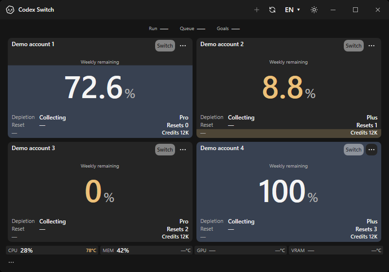
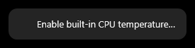
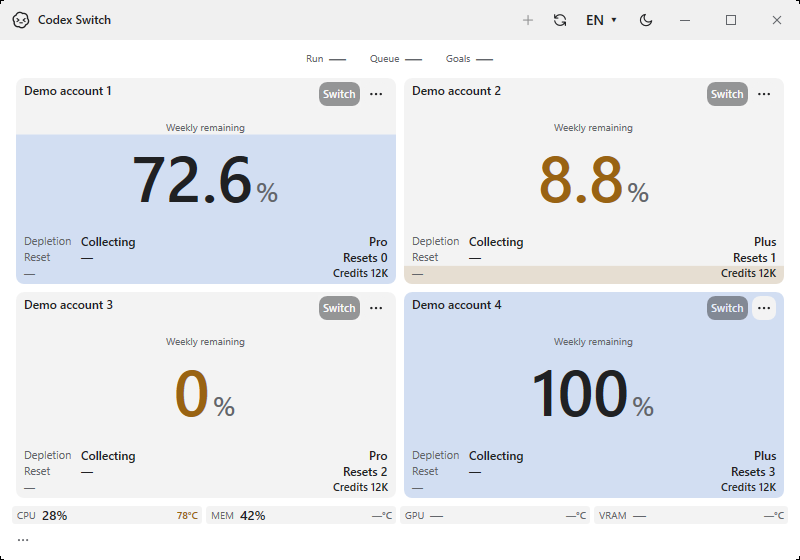

# Built-in Windows CPU sensor evidence

Issue85 / PR86, source1.40.5. Capture and production verification checkpoint: `ecbe30fdb4b6d36b7f1ef3035ceb4a6fe02a7adc`, native Windows x64/.NET10.0.13 on disposable hosted CI. No maintainer desktop window, personal data, account action or physical CPU acceptance is included. Published binaries remain1.40.2.

| Existing actual Windows baseline | New feature confirmation: actual Windows app |
| --- | --- |
|  |  |
| Baseline source1.40.4/main373263f; external CPU provider path. | Fictional78.125°C validates display/color only. It is not a physical sensor reading. |

The complete22-image [native capture manifest](windows/evidence.json) records exact image hashes, dimensions, runtime, architecture and scope. CPU setup/denied states remain `—°C`;8 additional CPU state/menu images accompany the14 existing language/theme/minimum/history/tooltip regression images. Twenty are actual own-window/popup captures; two older tooltip lifecycle checks are explicitly labeled WPF component renders. Exported PNGs have no private metadata. All22 were visually inspected. Inputs are fictional from inception, so no reversible blur or private source pixels are published.

## Actual worker and driver checks

[Identifier-free native receipt](verification.json), exported and independently verified against GitHub artifact SHA256/size/source:

- Actual published account app verifies its embedded worker digest, current-user/PID-bound output-only pipe and fresh status. Immediate/early shutdown and disposed-start refusal are included.
- Five real NativeAOT worker lifecycle/security checks cover malformed launch/nonce, parent start time, actual peer PID, fresh packets, wrong-server refusal and exit on disconnect.
- On disposable hosted Windows only, the fixed official PawnIO2.2.0 installer passes its pinned hash and Authenticode checks and starts the actual signed driver. Seven driver/worker checks additionally accept the unchanged signed module and reject its tampered bytes. No test-signing, unrestricted driver or security exception is used.
- This hosted runner reports **PlatformUnsupported**, before/after driver setup. `nativeSensorValueAccepted` is **false**. CPU register availability differs across hosted machines; an actual read failure retains its bounded Win32 error and is not converted into Celsius. Driver/signature/IPC success does not claim a successful physical-temperature read.

Local checks are windowless:38 temperature/register/framing/worker-integrity/setup-description contracts,42 language-pack API checks,9×383 catalogues, existing hardware8, repository/link/privacy checks and complete Windows compile. No new runtime package or external hardware-monitor dependency is introduced. The worker has no account assembly or CLR startup directory and exposes no hardware-control/input API. The account app retains normal privileges; setup/UAC remain explicit CPU-menu actions. [Implementation/setup and coverage](../../TEMPERATURES.md#built-in-windows-cpu-sensor).

The checkpoint passes Windows/repository/Mac Intel/ARM64 [Verify39006296228](https://github.com/Gaebabi/codex-switch/actions/runs/39006296228); Linux regression and final-head six-check promotion/review are recorded in PR86. Follow-up changes correct the CPU-specific missing-provider tooltip and select setup from the native worker status even when an external WMI value is present. Final artifacts must independently confirm current native UI/worker checks; the committed pictures retain their explicit capture revision. Owner physical CPU activation/reading remains unrun because no local installation/UAC/window is permitted during the gaming session. This limitation is preserved rather than inferred from synthetic UI or VM results.
