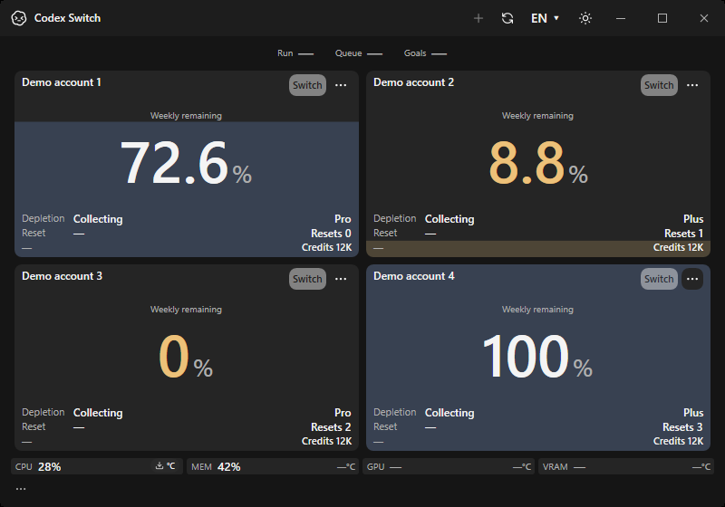
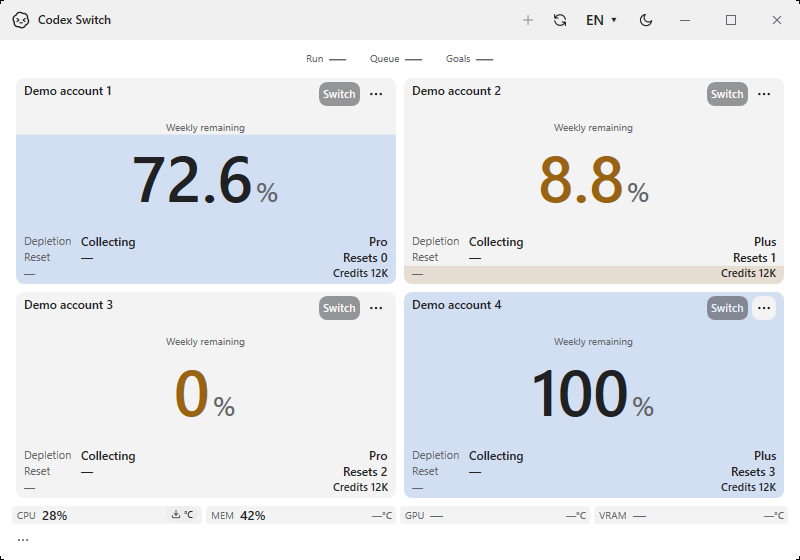
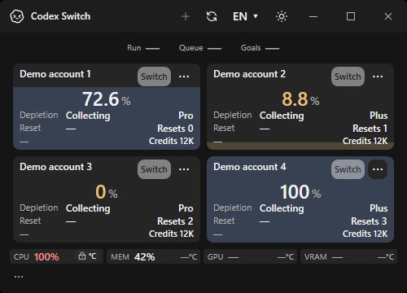
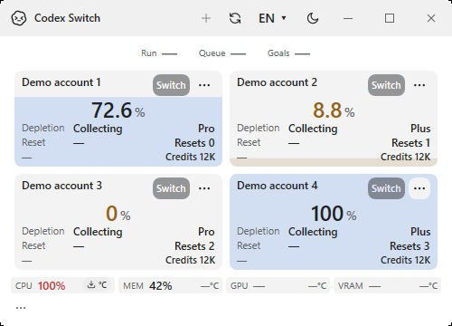
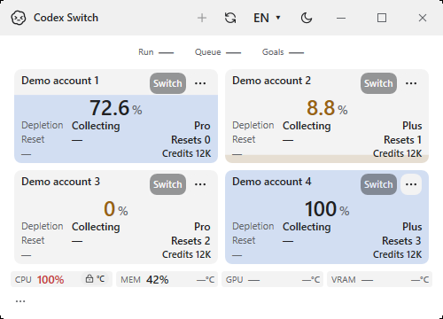

# Discoverable CPU temperature setup

Issue [#89](https://github.com/Gaebabi/codex-switch/issues/89), PR [#90](https://github.com/Gaebabi/codex-switch/pull/90), source **1.40.7**. These are actual native Windows x64 application windows on disposable CI, with fictional accounts and sensor inputs. No owner desktop, account names, device identity, private paths or authentication pixels are used. Image metadata is stripped and SHA256 values are recorded in [the manifest](evidence.json).

| Before: right-click menu required | After: visible download button |
| --- | --- |
|  |  |
|  |  |

The **download + °C** button appears when a driver is missing. **Lock + °C** requests session authorization for an installed driver; an incomplete package shows help. The button replaces the unavailable temperature placeholder, preserving the compact footer. The ordinary right-click menu is retained. Installation, download and UAC still require explicit consent; the account app remains unprivileged.

| Minimum 500×360, 100% CPU: installation | Minimum 500×360, 100% CPU: authorization |
| --- | --- |
|  |  |
|  |  |

Native assertions check that the button is visible only in the declared setup states, exposes its localized accessible action, disables during an outstanding action and recovers afterward. Minimum-size checks require the button to remain inside its cell and separate from the full 100% utilization label. The existing custom tooltip owner and all other gauges are preserved.

When a fresh reading arrives the action disappears and Celsius is displayed: [dark](after-dark-available.png), [light](after-light-available.png). The full authorization states are [dark](after-dark-denied.png) and [light](after-light-denied.png). The fictional 78.125°C verifies display/color only; it is not a physical measurement.

## Revisions and verification

- Before: native capture `ecbe30fdb4b6d36b7f1ef3035ceb4a6fe02a7adc`, source 1.40.5, retained from the built-in CPU gallery.
- After: native capture `26789afbee5330c0638e41f77ad65a9a1d2b3bc0`, source 1.40.7, .NET 10.0.13. The Windows job in [Verify39011088500](https://github.com/Gaebabi/codex-switch/actions/runs/39011088500) passes the published app and exports 36 inspected-schema images. This focused gallery retains 10 after and two before images. Subsequent evidence/documentation commits retain this explicit capture revision.
- [CPU integration/driver receipt](cpu-sensor-windows.json): published-app digest/real refreshed-worker output IPC, normal worker lifecycle, signed-driver/module acceptance and tamper refusal. The hosted VM returns a real `ReadFailed` status; no physical temperature success is inferred from it.
- [Disk regression receipt](disk-io-windows.json): 22 hardware checks and actual native read/write counter availability, without a benchmark or device identity.
- Local windowless checks pass 38 temperature/security contracts, 42 language API contracts and nine complete 402-message catalogues. A separate real normal-worker refresh recognizes the already installed driver as access denied without elevation, GUI or UAC.
- Final exact-head six protected checks, current artifact validation, recorded author self-review and authorized merge are tracked in PR #90. Author self-review is not independent approval. Public binary downloads remain 1.40.2.

Before deciding to install, the action replaces the old normal worker and awaits a fresh capability packet. This fixes a stale `ProviderMissing` result after a driver was installed while the app was open; an existing driver needs authorization rather than reinstallation. Installer exit 3010 is a restart notice without reboot. Setup failures report the bounded Windows code and do not imply damage to the account store.

The owner's separately authorized installation returned a fresh physical Tctl value through the production account-free collector, and the owner confirmed Celsius in the real app after correcting a stale desktop shortcut to the verified 1.40.6 package. This private-device acceptance is separate from the fictional pictures and does not substitute for the 1.40.7 native UI checks. No owner screenshot or raw diagnostic is published.
