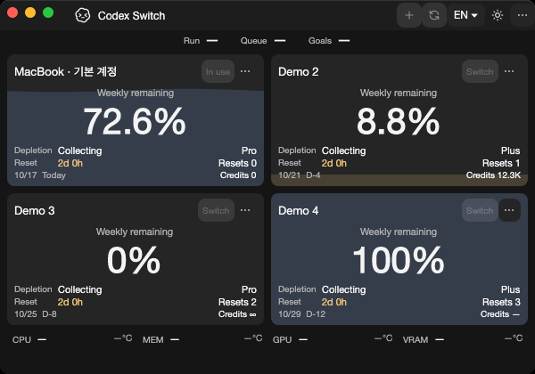
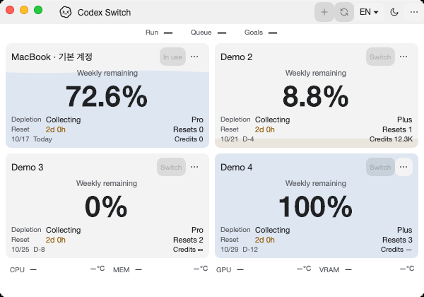
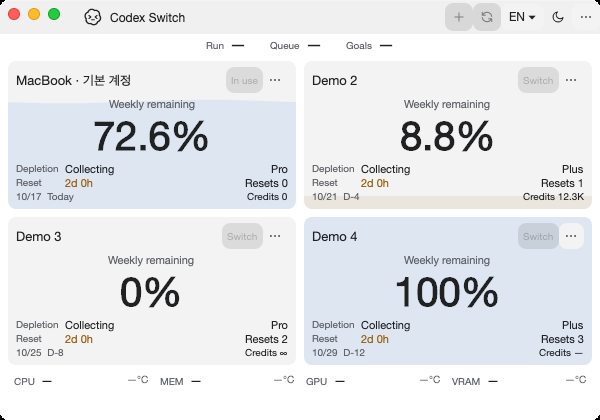
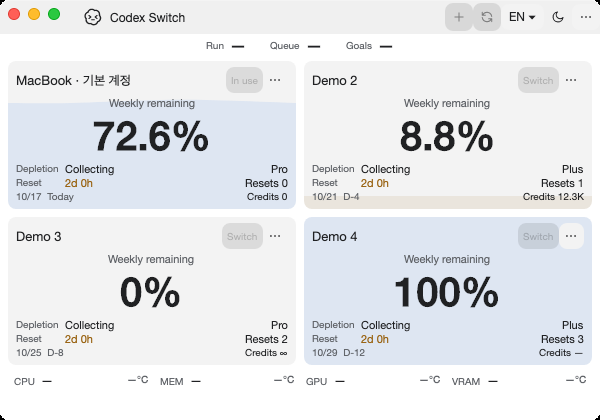
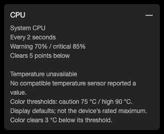
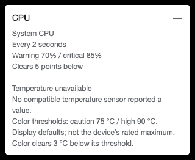
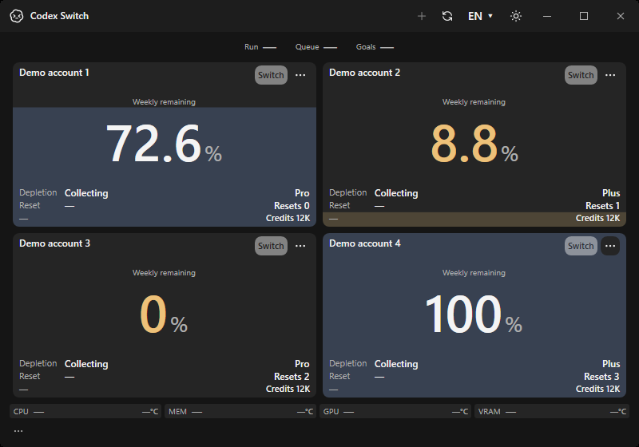
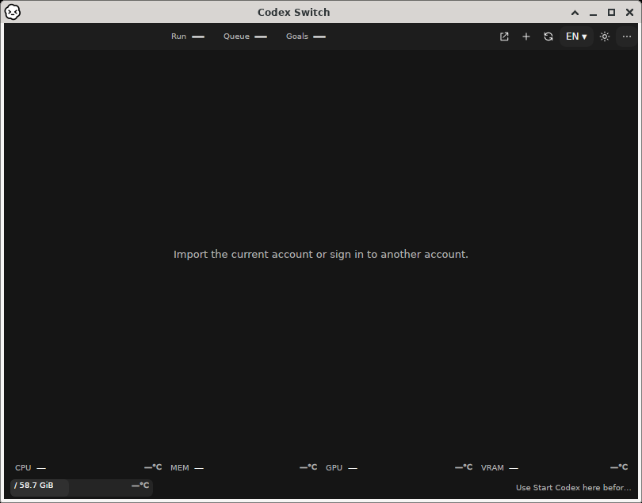

# Dependency compatibility and security evidence

Tracks [issue83](https://github.com/Gaebabi/codex-switch/issues/83), [integration PR84](https://github.com/Gaebabi/codex-switch/pull/84) and original Dependabot9/10/11/12/13/46/48/49. Source1.40.4 upgrades both Avalonia.Desktop/Fluent together to12.1.4 and retains their original bot heads. Published binaries remain1.40.2. Data/key/bundle/IPC identities, account/client trust, forecast math and WPF source are unchanged.

## Actual native Mac before and after

| Unmodified main1.40.3 / Avalonia11, ARM64 | Source1.40.4 / Avalonia12, ARM64 |
| --- | --- |
|  |  |
|  |  |

| Unmodified main1.40.3 / Avalonia11, Intel | Source1.40.4 / Avalonia12, Intel |
| --- | --- |
|  |  |
|  |  |

Captured on native hosted Mac ARM64/Intel workers at integration source `f1e6acb897be2a4f038af016d91a8d4e401c074f`, [Verify38952709111](https://github.com/Gaebabi/codex-switch/actions/runs/38952709111), self-contained .NET10.0.13 with software rendering in actual app-owned NSWindows. Each worker builds/runs an **unmodified** archive of main `083e283609242aa6b071e7f64e126e5de8668bf4` before the upgraded app; the original app and original export diagnostic source are retained. Current pinned Pillow performs metadata-free lossless PNG export. Original tree/archive hash, original application source and tested integration revision are distinguished in receipts. Native captures include their real title bars and exclude the pointer/desktop. The fixture intentionally retains a fictional Unicode account nickname in both versions; it is not a real account or untranslated UI.

The default/minimum/large sizes, both themes, English/Korean, language menu scrolling, history overflow and native menu bar are exercised. Framework font rasterization and capture timestamps can differ; [pixel comparison results](comparison.json) are recorded without claiming byte-identical frames. Native geometry/menu/state checks remain required rather than substituting pixel equality for functional verification.

## Custom resource tooltip regression

| Dark native popup after three reopen cycles | Light native popup after three reopen cycles |
| --- | --- |
|  |  |

The production resource cell uses the same custom tooltip instance through three ordinary ToolTip open/close cycles per theme. Its public `:open` state drives fade/reset, with reduced motion re-read on state changes. Avalonia12 caches a closed popup's control tree; child visibility/tree attachment is not the open-state contract. Assertions check the live state, fully visible custom surface after opening and reset surface after closing, followed by actual native-popup capture. This verifies native synthetic API lifecycle, not physical pointer input. No default-theme fallback or reflection/internal interface is used.

## Native receipts and security scope

| Native target | Before | After |
| --- | --- | --- |
| Mac ARM64 | [16 actual window/popup PNGs](mac-arm64-before/evidence.json) | [18 actual window/popup PNGs](mac-arm64-after/evidence.json) |
| Mac Intel | [16 actual window/popup PNGs](mac-intel-before/evidence.json) | [18 actual window/popup PNGs](mac-intel-after/evidence.json) |
| Windows x64 | Unchanged WPF implementation | [12 native app/menu/history PNGs and2 explicitly labeled tooltip component renders](windows-after/evidence.json) |
| Linux x64 | Existing preview capability boundaries retained | [12 native X11/Xvfb fixture PNGs](linux-x64-after/evidence.json) |
| Linux ARM64 | Actual native ARM64 process, not cross-publish | [12 native X11/Xvfb fixture PNGs](linux-arm64-after/evidence.json) |
| Ordinary Linux x64 Xfce | Normal installed application, empty isolated home | [53 checks /12 own-window PNGs, including direct-parent WM frames](linux-desktop/session.json) |

| Actual Windows application | Actual installed Linux application with native Xfce frame |
| --- | --- |
|  |  |

The ordinary Xfce session uses the per-user installed candidate through its normal desktop entry, actual encrypted GNOME Keyring and no account data. It verifies locked-startup automatic recovery, minimum/default/large sizing, pending-login Cancel, theme/refresh/close/reopen, CLI-only mode, data-preserving self-uninstall and two normal sandboxed original-client launch/Quit cycles with queried US/French key maps. Those two client pictures show offline startup only; they do not establish authenticated client use. Xvfb-only fixture images have no window-manager frame and are labeled separately from the ordinary Xfce frame above.

All six jobs pass at capture checkpoint `f1e6acb897be2a4f038af016d91a8d4e401c074f`: [Verify38952709111: four jobs](https://github.com/Gaebabi/codex-switch/actions/runs/38952709111) and [Linux38952708747: both native architectures](https://github.com/Gaebabi/codex-switch/actions/runs/38952708747). Mac history66-check interaction/state verification per architecture is recorded with [ARM64](mac-arm64-history/evidence.json) and [Intel](mac-intel-history/evidence.json) receipts. All146 exported images were visually inspected:144 native own-window/popup captures plus2 explicitly labeled WPF tooltip component renders. Final documentation-head CI/review/expected-head merge are recorded on PR84; capture checkpoints retain their exact original source.

[Official Actions tag/SHA/signature/runtime checks](official-actions.json) cover checkout7.0.1, setup-dotnet6.0.0, setup-node7.1.0, setup-python7.0.0 and upload-artifact7.0.2. All use Node24 and match their official released tags with verified GitHub signatures. Existing read-only workflow permissions, ordinary PR/push triggers, nonpersistent checkout credentials, explicit SDK/Python/Node versions, no-lifecycle locked npm install, sanitized explicit artifact paths, unique names, ZIP defaults and14-day retention are preserved. Upstream references and API migration decisions are in [the review](../../development/DEPENDENCY_REVIEW.md).

[Known-vulnerability query receipts](package-security-summary.json), dated2026-10-17: pinned Pillow12.3.0/PyYAML6.0.3 and actual Windows/Mac/Linux NuGet direct/transitive packages have no known feed findings. Python pins have no dependency edges. This is a scoped point-in-time feed check, not an assertion of complete security or absence of unknown vulnerabilities. Raw package paths, logs and authentication stay private.

Only synthetic profiles and app-owned windows/popups are exported. PNG metadata, dimensions and hashes plus GitHub artifact ZIP SHA256/size/workflow source are verified before export. No personal account, email, token, chat, private home, keyring contents, desktop or mouse pointer is published. Native hosted/UI/container proof does not certify a physical MacBook, full booted GNOME/KDE/Wayland/accessibility or real-account active-chat continuation. The existing owner Linux environment stays stopped with both accounts/keyring retained; its homes are never mounted into these jobs. All local commands are noninteractive/background; no local GUI test is run.

Main protection requires PRs, resolved review conversations and the six named GitHub Actions checks on an up-to-date branch, including admins; force pushes/deletion are forbidden. Approval count0 supports the single-maintainer workflow. Author self-review is explicitly not independent approval. All eight original PRs are promoted only via the reviewed integration merge commit and checked for actual merged state afterward.
