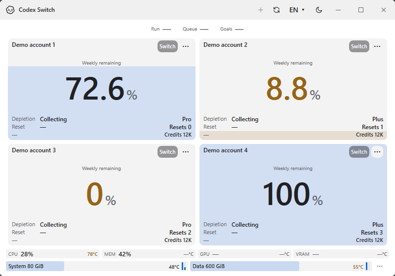
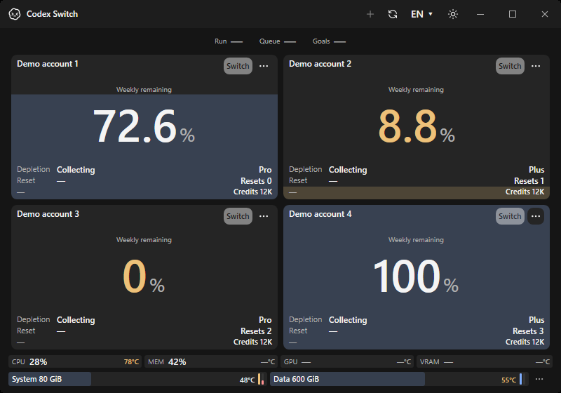
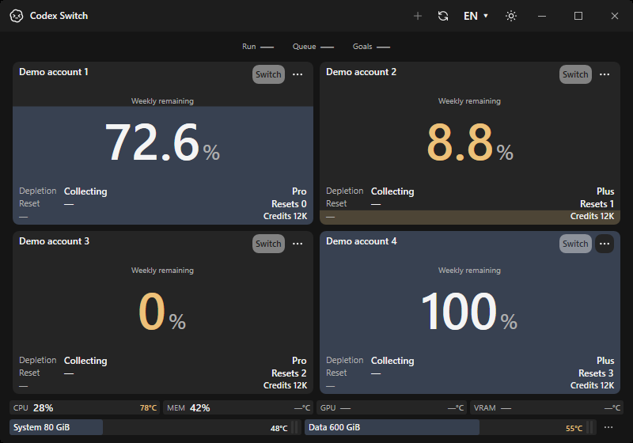
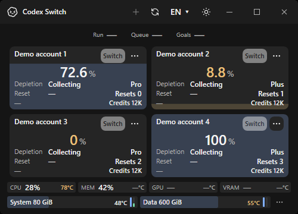
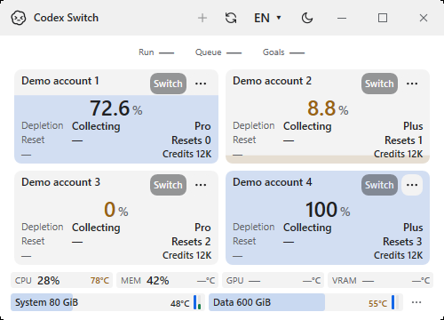
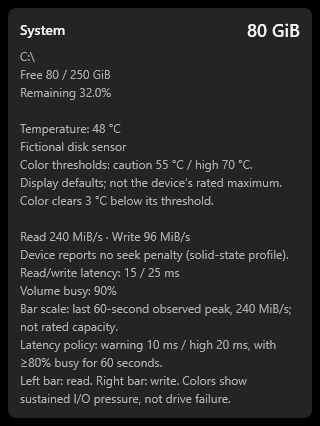
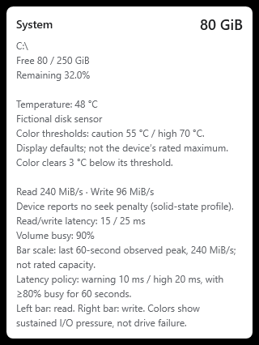

# Disk read/write gauge confirmation

Issue87 / PR88, source1.40.6. Actual native Windows x64/.NET10.0.13 application captures from checkpoint `b6ed2ba7b422c3193d8445bc5e87fa60f2ef82e5`. Only this app's own windows/popups are captured, with fictional accounts, volumes, sensor values and I/O samples. No personal desktop, real account or private device identity is used. These pictures prove the implemented UI, not a disk benchmark or manufacturer rating.

| Normal dark | Normal light |
| --- | --- |
|  |  |

| Sustained read warning/write high pressure | Unavailable I/O stays empty |
| --- | --- |
|  |  |

| Minimum500×360 dark | Minimum500×360 light |
| --- | --- |
|  |  |

| Actual dark tooltip popup | Actual light tooltip popup |
| --- | --- |
|  |  |

The two3px bars sit beside Celsius without increasing the24px footer. Left is read, right write. In the pressure case, read latency15ms triggers the no-seek warning and write25ms the high state after60seconds of90% busy time. The tooltip discloses the observed peak scale and explicit latency policy, rather than claiming an SSD maximum or drive failure. The second fictional drive independently shows normal read/idle write, with its temperature color retained. Native assertions verify accessible direction/rate names, two-disk minimum geometry and fixed footer height.

The [32-image source/runtime/hash manifest](windows/evidence.json) includes10 new disk captures and22 existing CPU/language/theme/size/history/tooltip regression images. Thirty are own-window/popup captures and two are explicitly labeled WPF tooltip component renders. All32 exported PNGs were visually inspected and contain no private metadata; inputs are fictional from inception, so no private pixels or reversible blur are published. [Existing pre-feature native dashboard baseline](../dependency-updates/windows-after/en-dark-800x560.png).

## Actual native counter verification

The [identifier-free native receipt](verification.json) is separate from screenshot fixtures. It records21 passing hardware/disk checks and **actual read/write/busy counters available** on disposable hosted Windows. Its backing-device profile is **Unknown**, so it does not infer manufacturer performance or latency warnings. No generated disk I/O, filesystem contents, device names/serials or account actions are used. The local windowless test also observed actual counters with a reported no-seek profile; owner values/identities are not published.

Portable checks cover bounded capability bytes, unsupported/ambiguous profiles, real zero/binary units, peak expiry, sustained independent busy/latency gates, recovery/gaps, invalid/stale data and nine complete language packs. Existing storage, account/client/security, manual switching/continuation and GPU/temperature contracts remain intact. [Sampling, profile policy and limitations](../../DISK_IO.md).

The final source adds a platform-case-sensitive drive-cache identity regression, raising Windows hardware coverage from21 at capture to22. CPU86 is merged at mainfd16694 and integrated before the final PR88 head. These follow-ups do not change the displayed disk layout/fixture values; final artifacts independently validate the current implementation.

The capture checkpoint passes native Windows [Verify39006942301](https://github.com/Gaebabi/codex-switch/actions/runs/39006942301); final exact-head six checks, final artifact/source validation, recorded author self-review and protected-main merge are tracked in PR88. CPU85/86 is a separate dependency and its owner physical-reading limitation remains explicit. No local window/UAC, benchmark, personal installation update or binary Release is included; published downloads remain1.40.2.
