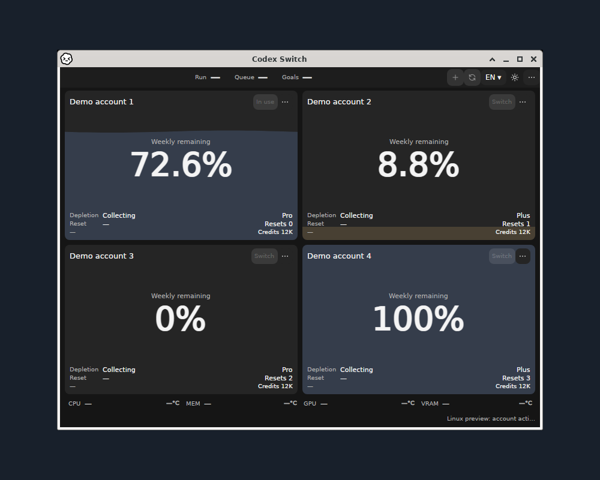

# Linux terminal verification

Source1.41.0 / [issue97](https://github.com/Gaebabi/codex-switch/issues/97) / [PR98](https://github.com/Gaebabi/codex-switch/pull/98). These commands are absent from published1.40.7 downloads. [Setup and command contract](../../development/LINUX_TERMINAL.md).

## Existing application baseline

**Before · Linux GUI:** the existing graphical app; this picture does not establish terminal command support. Its own capture source and scope remain in the [versioned gallery](../../media/release-1.40.7/README.md).

## Actual native terminal confirmations

**Linux x64 · Ubuntu24.04 · actual xterm/Xfwm4 frame:** the published native source executable runs `cli switch` and `cli list` against two fictional encrypted accounts. DISPLAY is removed from each command's environment. The terminal confirms the selected account and retains both accounts. Original terminal/OS-frame pixels are unchanged; no titlebar composition, personal home, login or account is pictured. [Source, checks and image SHA256](linux-x64.json).

**Linux ARM64 · Ubuntu24.04 ARM runner · actual xterm/Xfwm4 frame:** the same real command flow on its native architecture. Identical deterministic fictional inputs can produce identical pixels; architecture/source proof is separate from image appearance. [Native ARM64 receipt](linux-arm64.json).

Capture checkpoint `58c715097eb4a1881e77a7a0d1915969fdc8ecea`, source1.41.0, [native CI39035664772](https://github.com/Gaebabi/codex-switch/actions/runs/39035664772). Both native architectures pass14 headless contracts with the actual standalone Codex CLI0.162.1 and real encrypted GNOME Keyring. The captured executable has the same production source as this evidence checkpoint. The exporter verifies original artifact digest/size/source, image SHA, original bytes and absent PNG metadata. Only the owned terminal's verified direct-parent OS frame is captured; desktop-root and unrelated windows are excluded.

The14 contracts cover credential-free output, existing account/preference preservation, import, exact previous-login backup, already-current idempotency, unknown/ambiguous account refusal, missing/non-CLI session refusal, actual external CLI conflict without process termination, native session-list semantics, TTY preflight, descriptor-bound resume arguments, exact session/folder/follow-up selection and unchanged configuration. No mocked executable, fake successful turn or owner account is used.

## Remaining acceptance

These pictures prove actual native terminal execution and account application with fictional data. They do not prove real authentication, inference or active-task completion. The current local network-disabled container passes15 headless cases and one additional actual CLI exec/interruption/production-switch/exact-session-resume verification: the original ID/folder and exactly one persisted Continue are observed before normal interruption. No model success is fabricated. Its final exact-head native CI receipt is pending. Real two-account CLI identity/context/inference/continuation still requires the owner's existing test keyring to be unlocked. Final results and six protected exact-head checks/review/merge remain in PR98. The original desktop/full-environment issues remain separate; no published binary Release or personal installation is replaced.
