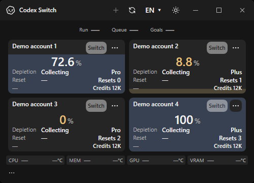
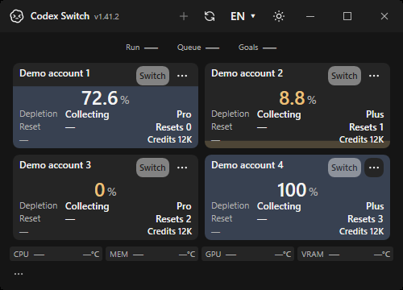
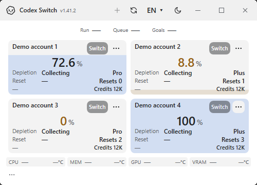

# Running Windows version: native evidence

Actual Windows x64 app-owned HWND captures with four fictional accounts, .NET10.0.13. Original PNG pixels are unchanged; there is no desktop capture, private account, titlebar composition or substituted version text. These pictures verify UI rendering, not authenticated switching, installed-owner behavior or physical sensors.

Before: source `98af9e4687d26bcc14198d8adc71922f0ca46d89`, v1.41.1, [native run39566727145](https://github.com/Gaebabi/codex-switch/actions/runs/39566727145).

After: source `ddfb44f176c02f81a60b412b56b0724ac5d5c8a0`, v1.41.2, [native capture run39616707274](https://github.com/Gaebabi/codex-switch/actions/runs/39616707274). The completed native capture/export steps provide the images and eight passing version/bounds checks. This capture checkpoint is distinct from the final documentation-head six-job promotion gate.

| Theme / minimum size | Before: no version | After: muted running version |
| --- | --- | --- |
| Dark, 500x360 |  |  |
| Light, 500x360 |  |  |

Full 800x560 original captures: [before dark](before-dark-800x560.png), [after dark](after-dark-800x560.png), [before light](before-light-800x560.png), [after light](after-light-800x560.png).

[Source, image hashes and native checks](evidence.json). The eight English/Korean, dark/light, minimum/large cases assert that the visible label matches the loaded application assembly and its bounds stay within the titlebar without intersecting action controls. The source-built local Windows compilation separately passed with zero warnings/errors. No owner process was restarted or installation replaced; published binaries remain1.41.1.
