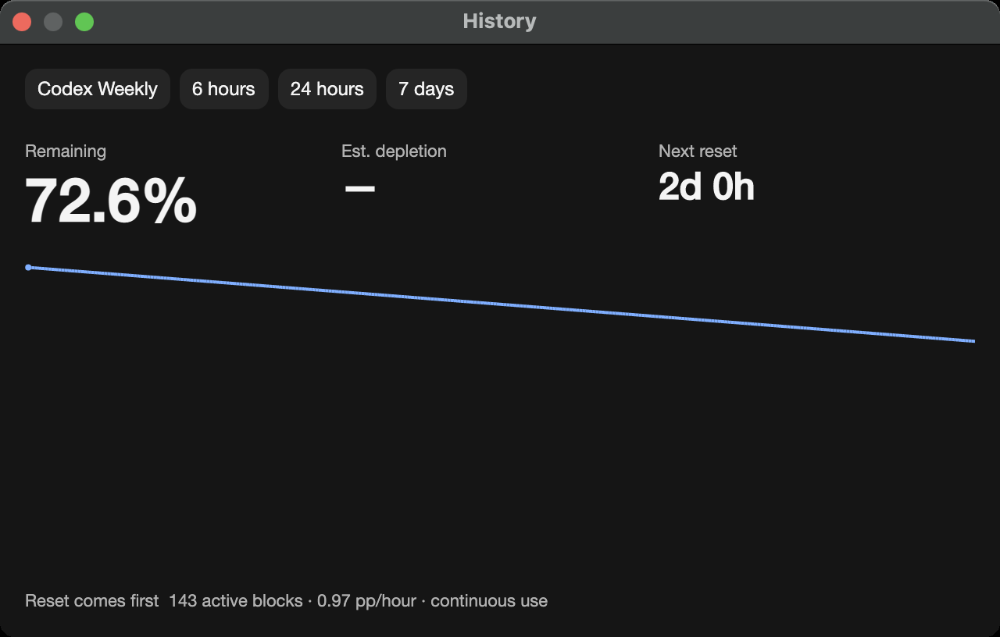
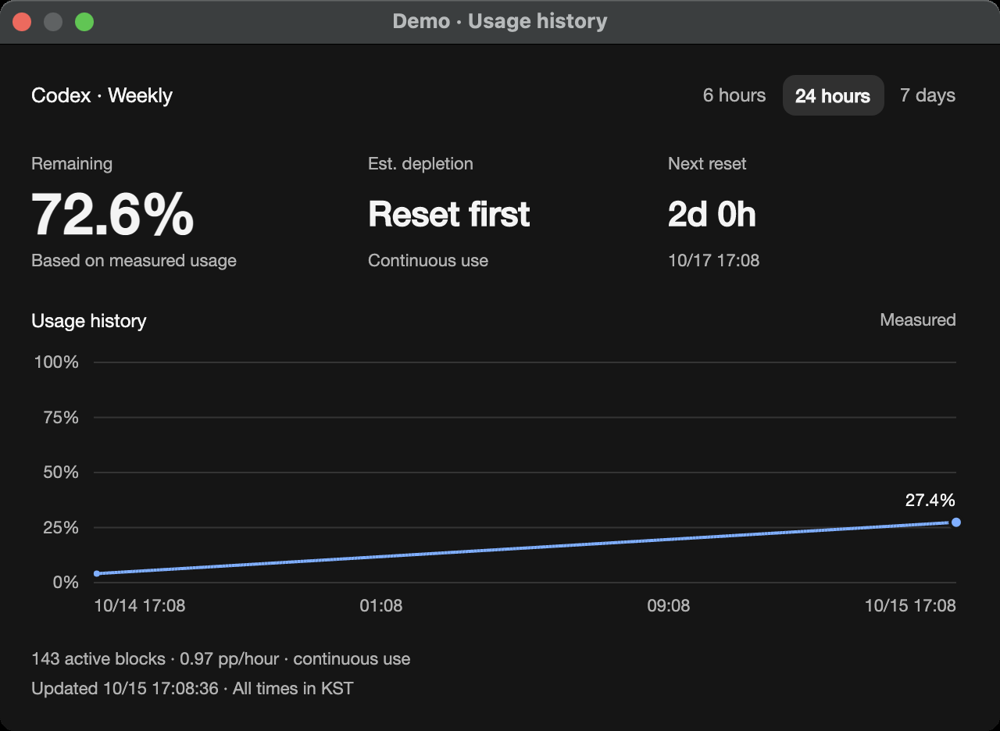
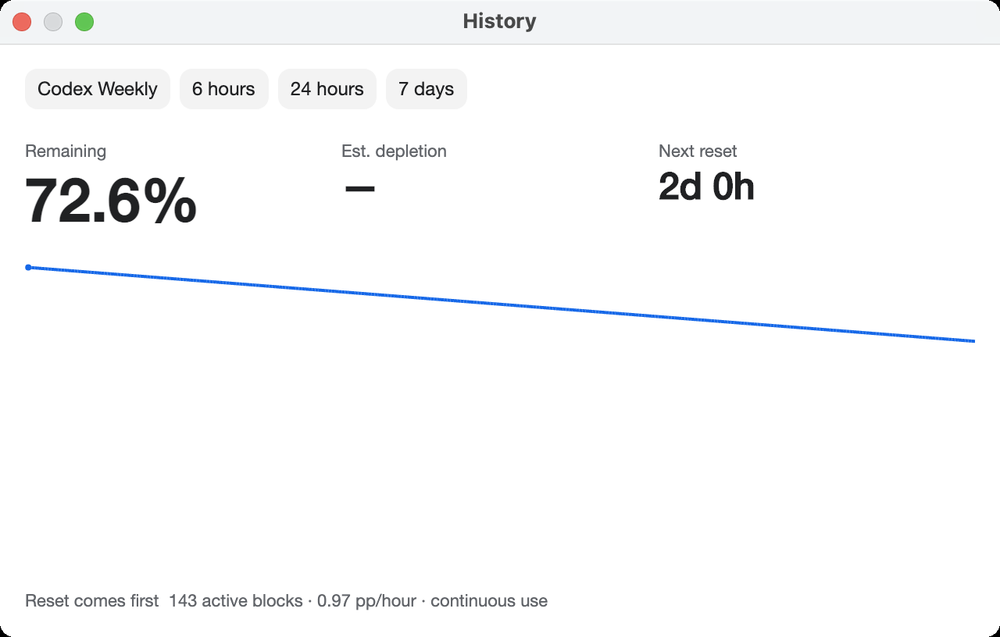
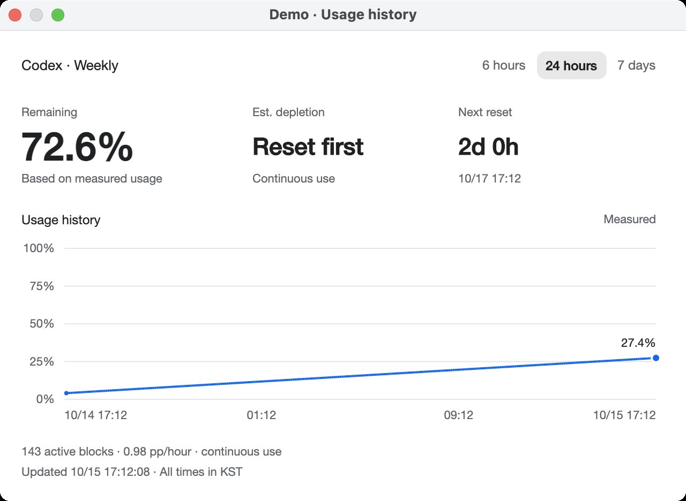
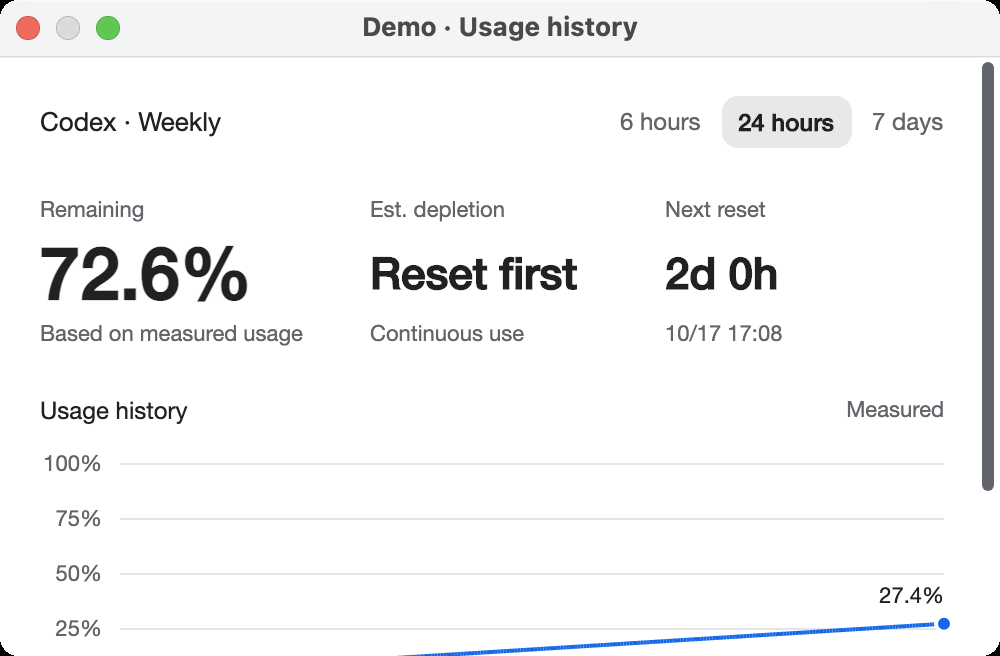
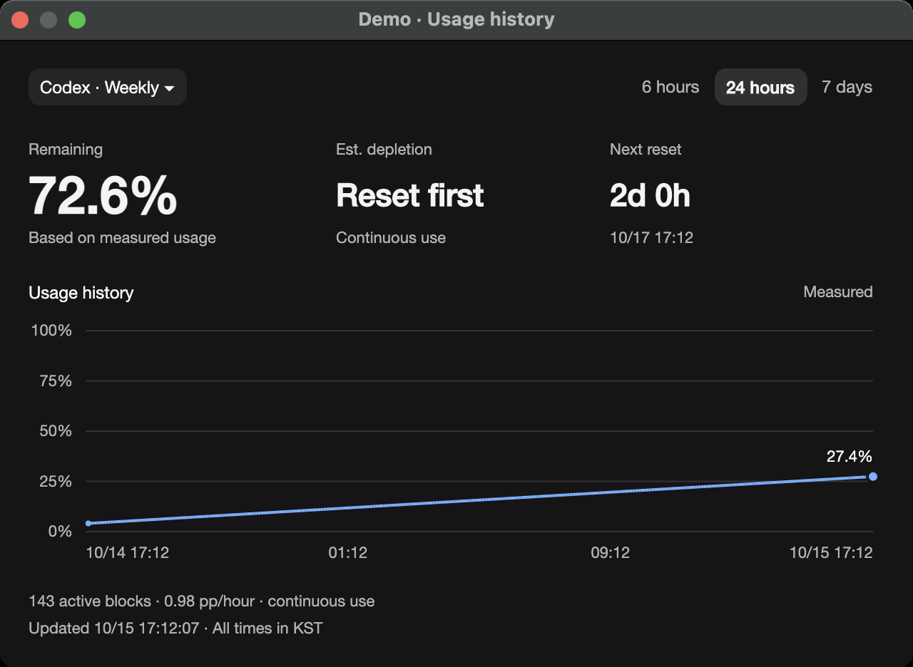
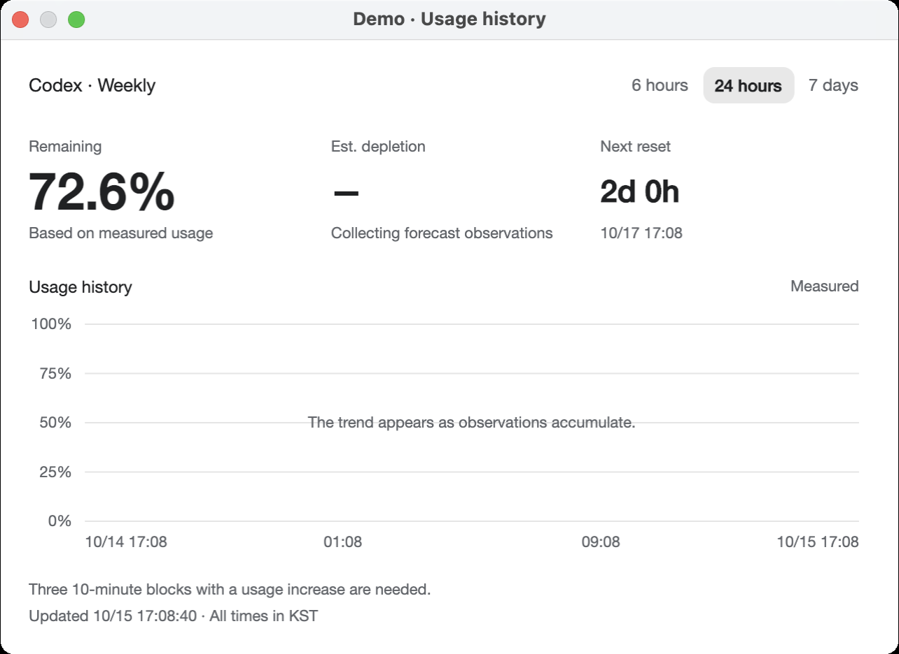
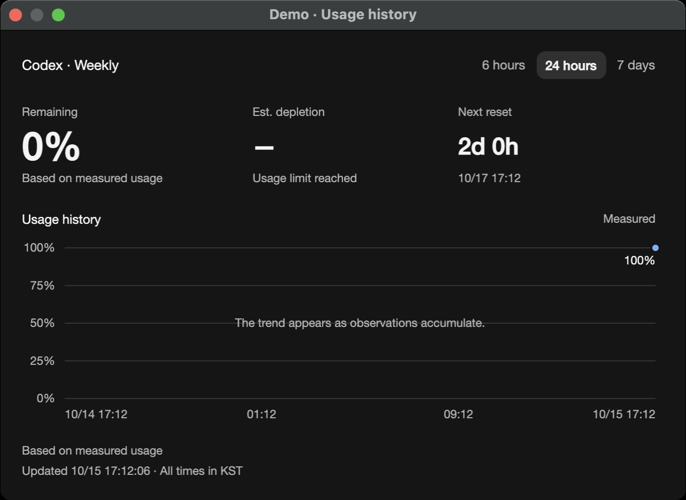
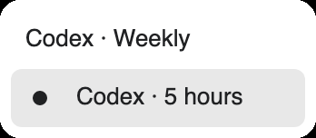

# Usage history design evidence

Tracks [issue #64](https://github.com/Gaebabi/codex-switch/issues/64) and [PR #65](https://github.com/Gaebabi/codex-switch/pull/65). The approved design improves the shared Avalonia history window used by macOS and the Linux source preview. Windows WPF has a separate history view. The forecast model, quota/reset segment selection, data/key/IPC identities and supported-platform gates are unchanged.

## Actual application before and after

| Dark before | Dark after |
| --- | --- |
|  |  |

| Light before | Light after |
| --- | --- |
|  |  |

Source `ec26e9fa9ee008b880ec8717a1e5b04f23781fe5`, app 1.37.0, native macOS ARM64. The history window and chart sources are unchanged in an external source archive; capture-only host instrumentation supplies a fictional Demo account and the same synthetic usage pattern in both themes. Increasing measured usage is drawn downward, chart axes are absent, and the selected range is indistinguishable from other buttons. [Baseline image hashes and capture scope](before/evidence.json).

After: source `fe6c3e4ef7396c90719f48bdd7127c0e2ad10703`, app 1.38.1, self-contained .NET 10.0.13 on native macOS ARM64, software rendering. The actual published-folder executable runs `--verify-history`; this is the implemented production history window, rather than the earlier design prototype. Before and after use the same machine, 2× capture scale and synthetic 4–27.4% growth pattern. Capture times differ. The default content size grows from 640×380 to 640×440; the existing 500×300 minimum remains scrollable. [All fourteen after PNGs, 66 interaction checks and source/runtime/hash receipt](mac-arm64/evidence.json).

The used-quota chart now rises with increasing usage, shows percent/date/time axes and the last measured value, and retains reset/gap discontinuities. Quota and range controls are distinct. Range controls use accessible toggle semantics with the existing neutral Button theme, avoiding the framework's bright checked fill. Remaining quota is visually separate from used quota; reset-first/collecting/exhausted/stale states are explained. A one-second window timer updates countdowns/forecast states without replacing focused controls; closing the window stops it.

## Native interaction and state confirmation

| Minimum window with reachable vertical scroll | Multiple quota selection |
| --- | --- |
|  |  |

| Empty observation history | One measured point at the limit |
| --- | --- |
|  |  |

The native probe exercises normal range callbacks and encrypted vault saves on a disposable diagnostic directory, checks selected range/presentation colors, switches quotas through the actual menu callback, verifies absent data stays unavailable and scrolls the minimum window to its footer. Its temporary key uses the existing guarded diagnostic Keychain cleanup; the Codex home remains absent. The screenshots verify presentation and synthetic interaction, not real login/switching/resumption. All new published screenshots, captions and issue/PR documentation use English; localization remains supported.

## Verification

- `dotnet publish src/macos/CodexSwitch.Mac.csproj -c Release -r osx-arm64 --self-contained true -p:UseSharedCompilation=false`: passed; complete 227-file package, runtime 10.0.13 and all nine managed project assemblies inspected.
- Published app `--verify-history`: 66 native checks and fourteen own-window/popup PNGs passed. `verify-history-evidence.py` requires the complete declared set and strips metadata.
- Existing published app `--verify-ui`: 21 native layout/menu/history checks passed. Existing queue/WAL fixture verification: 23 passed.
- Localization production API: 42 passed; all nine packs validate 372 messages. Native shared composition: 9 passed, including the new percent-axis/reset-gap regressions and ordinary trayless close.
- Document-link tests: 7 passed. Privacy-audit rejection tests: 5 passed. Tracked-tree privacy, UTF-8/local links/YAML and whitespace checks passed before each push.
- [PR #65](https://github.com/Gaebabi/codex-switch/pull/65) records exact-head CI, target-runner artifact inspection and author review. Both native Mac jobs export fourteen English history images and their receipts; both Linux source-preview jobs and existing Windows checks remain required. Local ARM64 checks do not establish those other native targets.

Only app-owned NSWindows are captured. Images contain fictional input from inception and have no ancillary PNG metadata. No personal desktop, credential, home path, account switching or chat resumption is involved. Public downloads remain 1.27.6.
