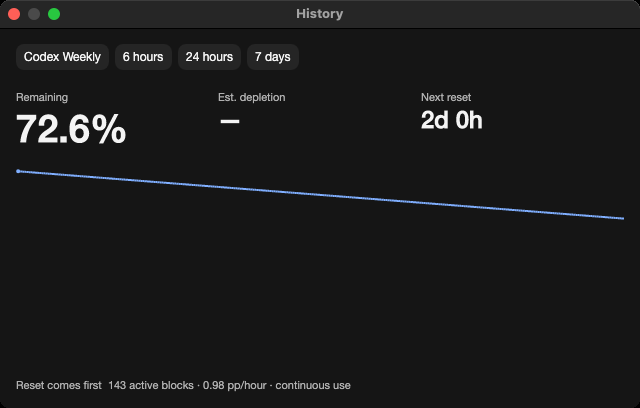
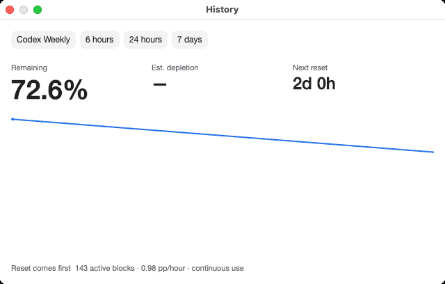
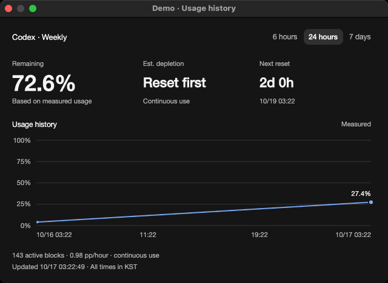
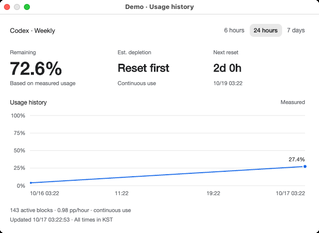
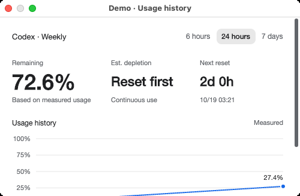
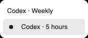
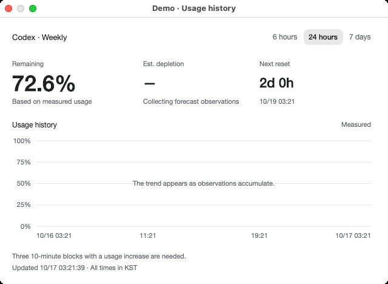
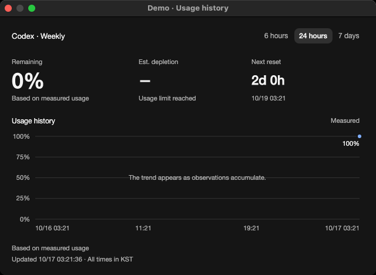

# Usage history design evidence

## Current-main native comparison — source 1.40.3

Tracks [issue #64](https://github.com/Gaebabi/codex-switch/issues/64) / [PR #65](https://github.com/Gaebabi/codex-switch/pull/65). Published binaries remain 1.40.2; this PR does not publish a Release or change personal installations. The shared Avalonia history view is used by macOS/Linux; Windows WPF has a separate view. Forecast math, storage/key/bundle/IPC identities and supported-platform gates are unchanged.

| Native Mac ARM64: main 1.40.2 before | Native Mac ARM64: source 1.40.3 after |
| --- | --- |
|  |  |
|  |  |

| Native Mac Intel: main 1.40.2 before | Native Mac Intel: source 1.40.3 after |
| --- | --- |
|  |  |
|  |  |

Captured by [Verify 38946398296](https://github.com/Gaebabi/codex-switch/actions/runs/38946398296) at test source `8c3a40feefdc4c9b7572599711603c3167e10b46`, native macOS ARM64/Intel, self-contained .NET 10.0.13, software rendering in actual app-owned NSWindows. Each worker builds an external archive of main `2bc551f9d36d5ec4e23f56af43237fecca47ac6c` (1.40.2). Original HistoryWindow/chart/theme bytes retain their SHA256; capture-only hosting supplies the identical fictional factory used by the corrected app. Before receipts record original source, renderer, fixture and adapter hashes. GitHub artifact ZIP SHA256 and size were verified before export.

Both versions use fictional Demo usage growing from 4% to 27.4%; captures occur a few seconds apart. Original content is 640×380; corrected default content is 640×440. Own-window PNGs include real native title bars and retain original pixels after ancillary metadata removal. The original curve falls as usage increases and lacks axes; the corrected used-quota curve rises on a 0–100% scale with dated KST axes and the last measured value. Remaining quota is separate, range selection has neutral emphasis and reset-first/collecting/exhausted/unavailable states are explicit. Countdown updates preserve focused controls and stop when the window closes.

| Minimum-size scroll | Quota selection | Empty history | Single point |
| --- | --- | --- | --- |
|  |  |  |  |

Each corrected native run passes66 assertions and exports14 English images: both themes × overview/minimum/empty/single/multiple/unavailable/quota. The ordinary range callback saves its setting through a disposable encrypted vault; quota callbacks update the chart. The probe checks selection contrast, data availability, overflow and scrolling to the footer at the existing500×300 minimum. Guarded diagnostic Keychain cleanup is retained; no Codex home is created. Before capture passes4 own-window/isolation checks per architecture.

| Architecture | Before source/runtime/image hashes | After source/runtime/checks/image hashes |
| --- | --- | --- |
| ARM64 | [2 PNG receipt](latest-main/before-osx-arm64/evidence.json) | [66 checks /14 PNG receipt](latest-main/after-osx-arm64/evidence.json) |
| Intel | [2 PNG receipt](latest-main/before-osx-x64/evidence.json) | [66 checks /14 PNG receipt](latest-main/after-osx-x64/evidence.json) |

All32 fresh images were visually inspected across both themes, states and architectures, with metadata/dimensions/SHA256 verified. Only fictional inputs exist in these windows; no personal account, authentication, keyring content, home path, chat, pointer or desktop is captured. This proves native synthetic UI/interaction, not authenticated switching/continuation, physical MacBook acceptance or Linux full-desktop support. The owner's MacBook slot and #5/#6/#7/#76 gates remain separate.

Verify38946398296 passes all4 jobs (repository, Windows isolated UI and native Mac ARM64/Intel). Native shared composition has9 checks; headless composition6 includes upward projection and reset/gap regressions. All9 language packs validate376 messages. Existing startup/security/client/SQLite/package checks and separate Linux x64/ARM64 jobs remain required. PR65 records final exact-head CI, author self-review and merge. Earlier captures below retain only their historical scope.

Historical source 1.37 /1.38.1 evidence, superseded by the current-main comparison

Tracks [issue #64](https://github.com/Gaebabi/codex-switch/issues/64) and [PR #65](https://github.com/Gaebabi/codex-switch/pull/65). The approved design improves the shared Avalonia history window used by macOS and the Linux source preview. Windows WPF has a separate history view. The forecast model, quota/reset segment selection, data/key/IPC identities and supported-platform gates are unchanged.

## Actual application before and after

| Dark before | Dark after |
| --- | --- |
|  |  |

| Light before | Light after |
| --- | --- |
|  |  |

Source `ec26e9fa9ee008b880ec8717a1e5b04f23781fe5`, app 1.37.0, native macOS ARM64. The history window and chart sources are unchanged in an external source archive; capture-only host instrumentation supplies a fictional Demo account and the same synthetic usage pattern in both themes. Increasing measured usage is drawn downward, chart axes are absent, and the selected range is indistinguishable from other buttons. [Baseline image hashes and capture scope](before/evidence.json).

After: source `fe6c3e4ef7396c90719f48bdd7127c0e2ad10703`, app 1.38.1, self-contained .NET 10.0.13 on native macOS ARM64, software rendering. The actual published-folder executable runs `--verify-history`; this is the implemented production history window, rather than the earlier design prototype. Before and after use the same machine, 2× capture scale and synthetic 4–27.4% growth pattern. Capture times differ. The default content size grows from 640×380 to 640×440; the existing 500×300 minimum remains scrollable. [All fourteen after PNGs, 66 interaction checks and source/runtime/hash receipt](mac-arm64/evidence.json).

The used-quota chart now rises with increasing usage, shows percent/date/time axes and the last measured value, and retains reset/gap discontinuities. Quota and range controls are distinct. Range controls use accessible toggle semantics with the existing neutral Button theme, avoiding the framework's bright checked fill. Remaining quota is visually separate from used quota; reset-first/collecting/exhausted/stale states are explained. A one-second window timer updates countdowns/forecast states without replacing focused controls; closing the window stops it.

## Native interaction and state confirmation

| Minimum window with reachable vertical scroll | Multiple quota selection |
| --- | --- |
|  |  |

| Empty observation history | One measured point at the limit |
| --- | --- |
|  |  |

The native probe exercises normal range callbacks and encrypted vault saves on a disposable diagnostic directory, checks selected range/presentation colors, switches quotas through the actual menu callback, verifies absent data stays unavailable and scrolls the minimum window to its footer. Its temporary key uses the existing guarded diagnostic Keychain cleanup; the Codex home remains absent. The screenshots verify presentation and synthetic interaction, not real login/switching/resumption. All new published screenshots, captions and issue/PR documentation use English; localization remains supported.

## Verification

- `dotnet publish src/macos/CodexSwitch.Mac.csproj -c Release -r osx-arm64 --self-contained true -p:UseSharedCompilation=false`: passed; complete 227-file package, runtime 10.0.13 and all nine managed project assemblies inspected.
- Published app `--verify-history`: 66 native checks and fourteen own-window/popup PNGs passed. `verify-history-evidence.py` requires the complete declared set and strips metadata.
- Existing published app `--verify-ui`: 21 native layout/menu/history checks passed. Existing queue/WAL fixture verification: 23 passed.
- Localization production API: 42 passed; all nine packs validate 372 messages. Native shared composition: 9 passed, including the new percent-axis/reset-gap regressions and ordinary trayless close.
- Document-link tests: 7 passed. Privacy-audit rejection tests: 5 passed. Tracked-tree privacy, UTF-8/local links/YAML and whitespace checks passed before each push.
- [PR #65](https://github.com/Gaebabi/codex-switch/pull/65) records exact-head CI, target-runner artifact inspection and author review. Both native Mac jobs export fourteen English history images and their receipts; both Linux source-preview jobs and existing Windows checks remain required. Local ARM64 checks do not establish those other native targets.

Only app-owned NSWindows are captured. Images contain fictional input from inception and have no ancillary PNG metadata. No personal desktop, credential, home path, account switching or chat resumption is involved. Public downloads remain 1.27.6.

