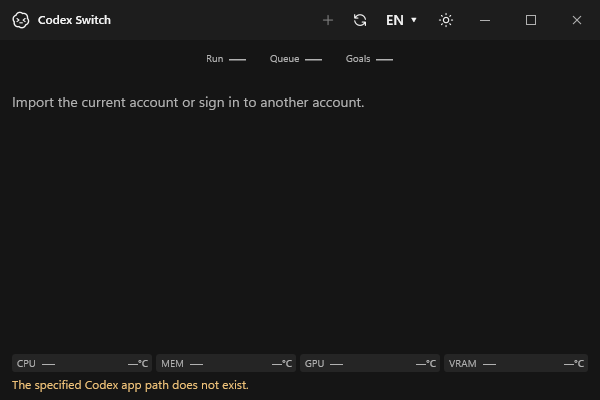
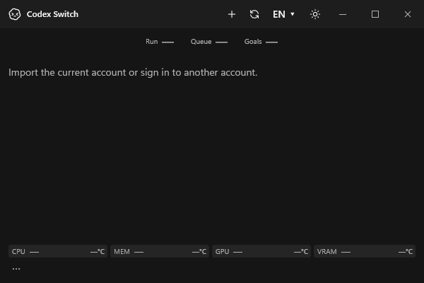

# Windows initialization recovery

Issue [80](https://github.com/Gaebabi/codex-switch/issues/80), included in release issue78/PR79: an initial client/login failure leaves `_ready` false. The former Windows manual refresh, tray refresh and timer all require `_ready`, so none can retry after Codex becomes available. Account actions correctly remain unavailable, but refresh must be able to retry initialization.

## Actual baseline


The actual1.40.1 WPF window uses an owned absent client path and empty disposable storage. No real account, login, client process or personal desktop is involved. The native own-HWND screenshot retains the real titlebar. The regression invokes the production initializer, actual refresh button and DispatcherTimer; it does not set `_ready` or replace service results. The baseline fails at “refresh remains reachable after initialization failure”.

## Corrected behavior

| Before correction: refresh disabled after failure | After correction: same window recovers on manual refresh |
| --- | --- |
|  |  |

| Initial failure still permits retry | Existing timer recovers automatically |
| --- | --- |
|  |  |

Code60db3c8 passes12 native WPF checks: failed initial discovery, disabled account addition, reachable refresh, retry in the same window, restored controls and absent canonical credentials, independently for manual-button and automatic-timer paths. In-flight initialization is shared and duplicate refresh input is disabled. The normal60s timer is retained; only the test's actual DispatcherTimer interval is shortened. The same local complete Windows build also passes93 existing isolated checks and .NET10.0.13 runtime inspection.

## Corrupt legacy runtime ownership

The affected installation also contained three old44-byte ownership records filled entirely with NUL bytes. Its canonical account token structure was valid; strict `CleanupStale` JSON parsing stopped initialization before account synchronization. Runtime ownership now uses the existing private atomic writer (exclusive staging, flush and replacement) instead of an in-place `File.WriteAllText`. The focused native ownership test binds the actual PID/start time and confirms malformed records are still rejected and preserved. No permissive parser, silent deletion, credential reset or key migration is introduced. Existing corrupt private runtime folders are preserved separately during the authorized local repair; their files and identities are never published.

Run on Windows with the normal CLI prerequisite available:

```text
dotnet run --project tests/windows-startup/CodexSwitch.WindowsStartup.Tests.csproj -c Release -p:UseSharedCompilation=false -- artifacts/startup-recovery/new-run
```

The later-available placeholder is discovered but never executed. Empty account storage avoids authentication/RPC/network. This proves UI initialization recovery only, not real account/client handoff. [Baseline receipt](baseline.json) / [corrected source/runtime/image/check receipts](evidence.json). Four metadata-free after-build PNGs and the original baseline were inspected before export.
