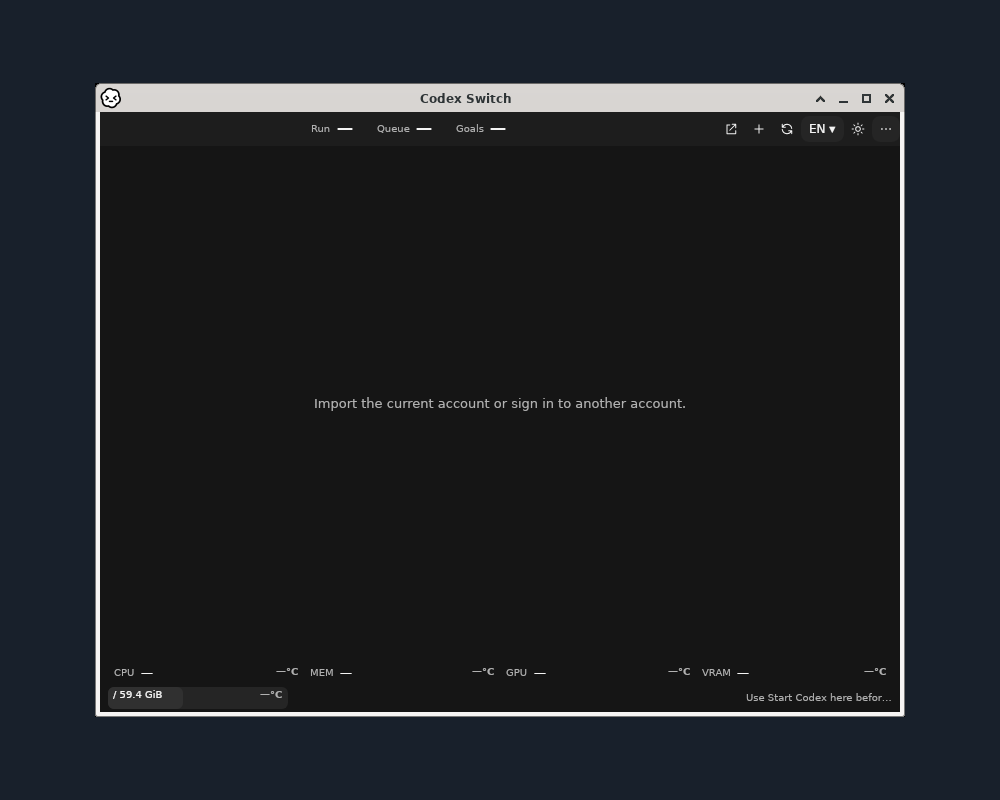

# Release1.40.1 app gallery

Actual native application windows on a solid `#18202b` background, centered without scaling. Each application's original titlebar/buttons and every source-window pixel are preserved. No personal desktop, mouse cursor, real account identity, login or private chat is captured. [Source/runtime/image SHA256 and placement receipts](gallery.json).

## Windows x64


The complete published Windows application runs on a native Windows worker. The four **Demo account** profiles are fictional; resources are unavailable in isolated UI mode. This verifies the program/window rendering, not an authenticated switch, live telemetry or inference. [Startup-recovery program comparison](../../evidence/windows-startup-recovery/README.md) separately verifies actual manual/timer recovery in empty disposable storage.

## Linux x64



The actual installed application runs as a normal user in an isolated Debian13/Xfce desktop session with xfwm4. The titlebar/controls are the real Linux window-manager frame. This is the ordinary empty-account UI, with no synthetic dashboard injection. Docker userspace execution is distinct from a booted VM, GNOME/KDE/Wayland, physical GPU or authenticated cross-account continuation. Linux downloads remain explicit integration previews.

## MacBook real-device capture — pending

The maintainer will add the MacBook screenshot. The slot is `docs/media/release-1.40.1/macbook.png`; add its exact source/app/macOS/architecture and SHA256 to the gallery receipt, then replace the pending text in all README languages with the image. Preserve the actual Mac titlebar and use a plain background. Remove original private pixels before optional blur, strip metadata and inspect the final PNG. No different-OS image or mockup substitutes for this capture.

<!-- MacBook screenshot slot: embed macbook.png here only after the maintainer provides the real-device capture and privacy/provenance review. -->

Mac Apple Silicon and Intel release packages are built and verified on their native macOS15 workers, including strict ad-hoc signatures, ZIP extraction and seven staged installation/update/preservation checks per architecture. Those CI results do not replace the owner's requested MacBook image or certify real account handoff/notarization.

## Reproduce the presentation export

Download the source-bound `native-ui-windows` and `desktop-session-linux-x64` CI artifacts, verify their GitHub ZIP digests and native receipts, then run:

```text
python scripts/render-release-gallery.py --windows artifacts/verified/native-ui-windows --linux artifacts/verified/desktop-session-linux-x64 --output docs/media/release-1.40.1
```

The exporter verifies original hashes and native scope, strips metadata, and checks byte-for-byte equality between each source window and its region in the saved canvas. Older component illustrations and native galleries remain in [the historical media index](../README.md).
