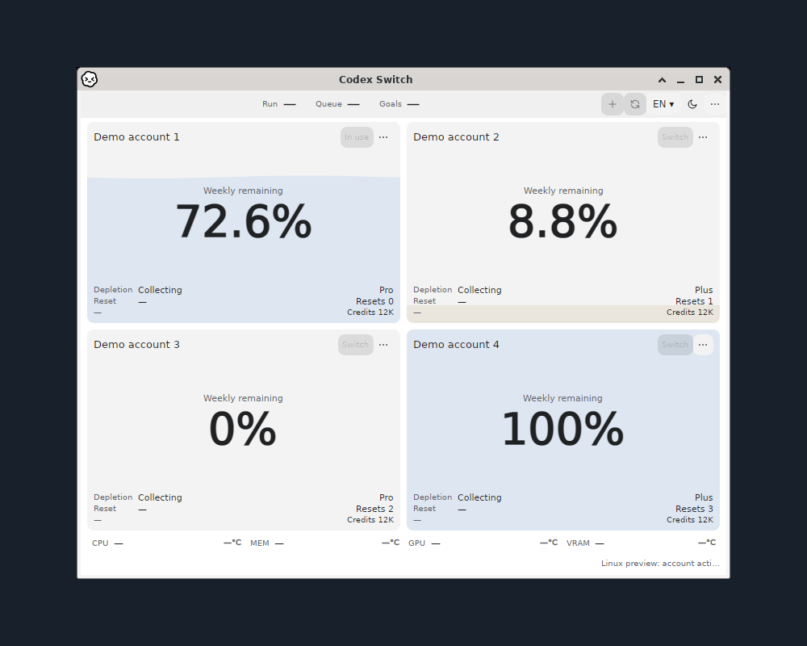

# Codex Switch1.40.7: actual app windows with OS-specific captions

Native application captures with fictional demo accounts. [Per-image original/output hashes, capture revisions and pixel-preservation receipt](gallery.json). Original pixels remain unchanged at1:1 on a centered1000×800 solid `#18202b` canvas. Metadata is removed; no personal desktop, account, authentication or cursor pixels are used.

## Windows x64

**Windows x64 · native WPF app:** fictional demo accounts and the actual CPU download/setup button. The app's own titlebar and controls are preserved. This checks rendering, not a physical CPU reading. Capture `a3f4d5f3a2e0c54378f5371682b1d928700c6c50`; [Windows verification](https://github.com/Gaebabi/codex-switch/actions/runs/39011565929) and [CPU before/after](../../evidence/cpu-setup/README.md).

## Linux x64: account cards and actual OS titlebar together

**Linux x64 · dark app · actual X11/Xfwm4 OS frame:** four fictional account cards and the real window-manager titlebar captured together. The titlebar is neither synthesized nor attached afterward. Only this app's original direct-parent frame was captured; the desktop/root window was excluded.

**Linux x64 · light app · same actual OS frame:** the same four demo accounts and genuine window controls. Light/dark refers to the app; the OS titlebar retains its real Xfwm4 theme. No personal login or account action is pictured.

Linux pictures come from `919b8c2229d6989b53fa70b4591b5b5899ed5bd6`, source1.40.7/.NET10.0.13, native Ubuntu24.04 x64 with real Xfwm4 on an owned X11 display. [Native CI](https://github.com/Gaebabi/codex-switch/actions/runs/39031306150) verifies12 language/theme/size captures per architecture using the actual app's explicit isolated demo mode. [App PID/direct-parent frame and source/hash proof](linux-framed.json). Titlebar and cards are part of one original capture; export preserves every frame pixel without a separate frame layer.

Checks require original `_NET_WM_PID`, direct child membership, non-root parent, actual Xfwm4 and the same parent after capture. A missing/unrelated frame fails. Four-card layout and text clipping pass before each capture. The ordinary installed Xfce session separately repeats both themes and requires original vault bytes and an empty auth home. This is native app rendering, not authenticated switching/continuation or full booted GNOME/KDE/Wayland desktop acceptance.

## Retained historical verification

The [unframed demo](linux.png) and its [released-source7645e74 receipt](linux-demo.json) remain as before evidence. The [empty-home installed Xfce window](linux-desktop.png) and [53-check session receipt](linux-session.json) retain sourcea3f4d5f and their initialization/lifecycle scope. Neither is substituted for the new framed account view.

Published1.40.7 binaries, tag/checksums and its release-time verification archive remain unchanged. This is a current-main capture/documentation correction with per-image provenance. Linux remains unsigned integration preview; demo cards do not establish real login.

**macOS · real MacBook screenshot: pending the maintainer.** Existing1.40.2 downloads remain. No other OS or CI image substitutes for the owner's MacBook capture.
