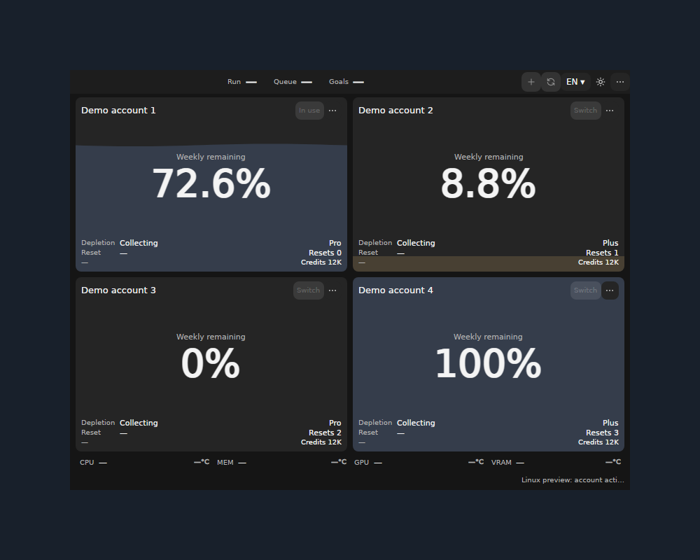
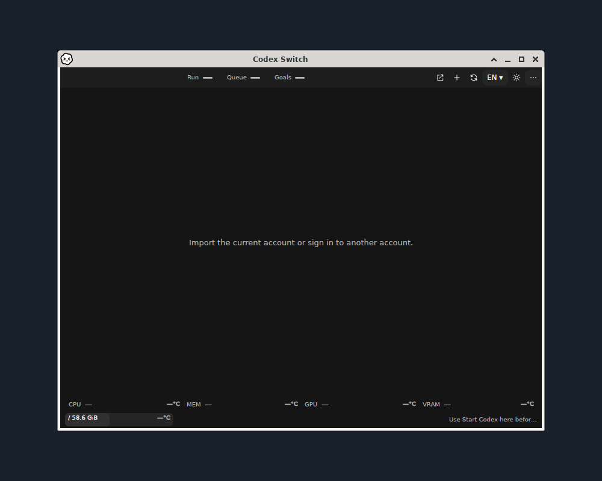

# Codex Switch 1.40.7: native Windows and Linux windows

Actual application windows from source1.40.7/.NET10.0.13. Capture revisions are recorded **per image**: the Windows and supporting Xfce frames retain `a3f4d5f3a2e0c54378f5371682b1d928700c6c50`; the Linux account overview uses the exact released source `7645e74e5285b3f8458333a0381a4a12e36eb357`. [Original/presentation hashes and scope](gallery.json). The overview's native x64 capture comes from [Linux39020165299](https://github.com/Gaebabi/codex-switch/actions/runs/39020165299), whose x64/ARM64 jobs passed before PR92 merged.

Windows uses the published WPF application with fictional accounts and sensor inputs. The download icon is a real button; driver/worker authorization remains explicit. This picture does not claim physical CPU availability. [Actual app before/after and sensor security evidence](../../evidence/cpu-setup/README.md).

The main Linux image shows **four fictional demo accounts** in the actual published Linux app, using its existing isolated UI verification mode. It presents the account cards, remaining quota and manual Switch controls without using any personal account or a real login. [Native source/runtime/original image receipt](linux-demo.json). This original app-owned X11 capture has no surrounding window-manager frame; none was synthesized or borrowed from another OS. It is a native UI confirmation, not authenticated account-switch/continuation acceptance.

## Supporting installed-desktop evidence

Linux uses the ordinary per-user installed app with an empty account home and real Xfce/xfwm4 frame in isolated Debian13 userspace. [53-check session receipt](linux-session.json) covers lifecycle, original encrypted-key preservation, automatic initialization after unlock and offline managed-client integration. It is not a booted VM, full GNOME/KDE/Wayland/ARM64 desktop or authenticated active-chat continuation claim. Linux stays an unsigned integration preview.

All original app pixels remain unchanged at1:1, centered on a solid1000×800 `#18202b` background. Existing titlebars are preserved, and no missing window-manager decoration is fabricated. No personal desktop, cursor, account identity or authentication pixels are captured. Metadata is removed and final images visually inspected. The retained empty-home installed-desktop image and53-check receipt establish their original lifecycle scope; the demo overview improves feature visibility. The published1.40.7 package/verification assets remain unchanged and keep their original release-time gallery; current main documentation contains this correction.

**MacBook real-device screenshot remains reserved for the maintainer.** macOS downloads remain1.40.2. Do not relabel CI pictures as the owner's MacBook capture.
