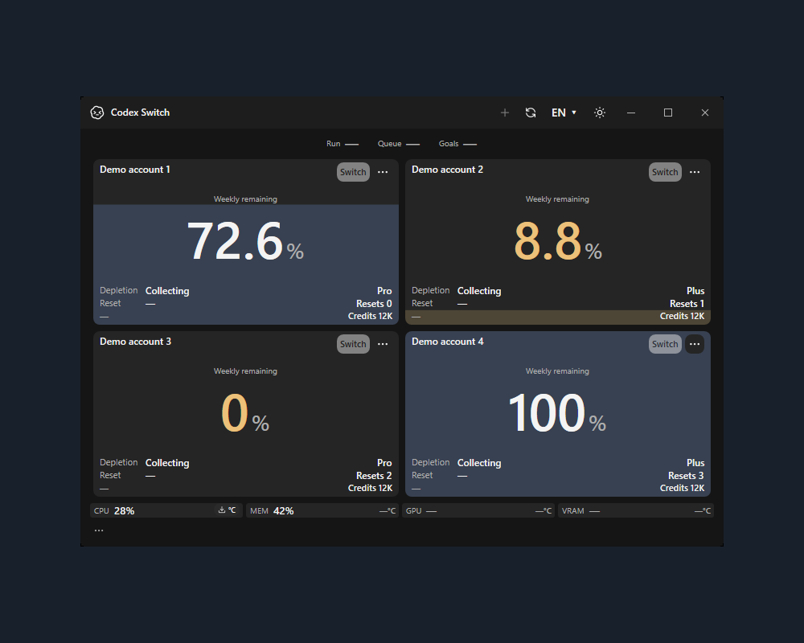
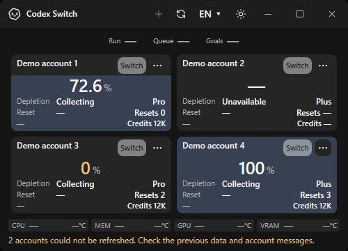
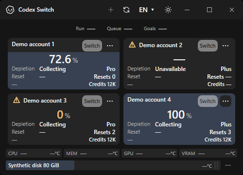
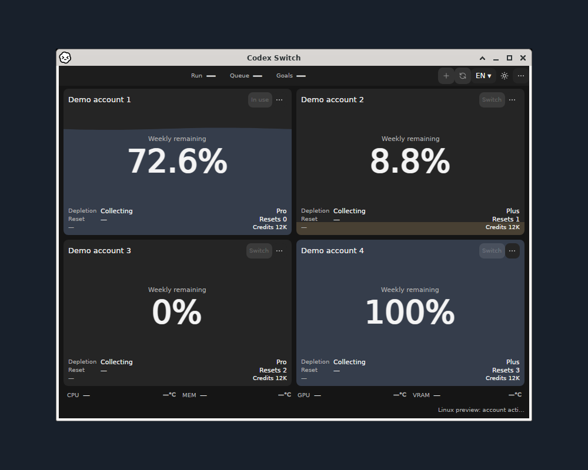
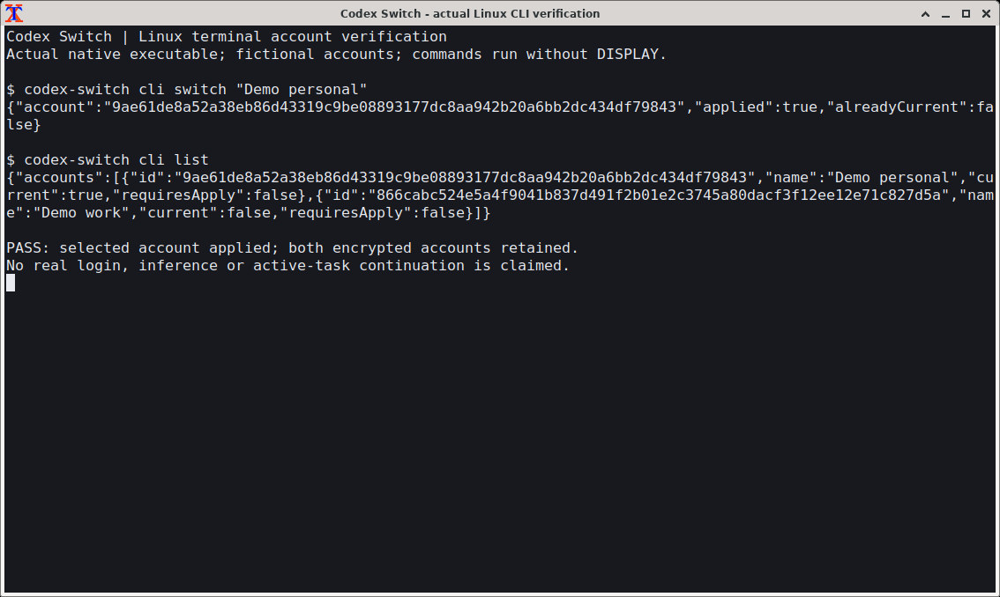

# Codex Switch1.41.1: native Windows and Linux confirmation

Actual application captures from native hosted CI, with fictional accounts and isolated data. [Per-image original/output SHA256, revisions, dimensions and pixel-preservation receipt](gallery.json) records provenance. Original app pixels are preserved at1:1 on a centered1000×800 solid `#18202b` canvas; warning popups and terminals retain their original dimensions. No personal screen, account, authentication, cursor or private metadata is included.

## Windows x64

**Windows x64 · native WPF app:** real app titlebar/controls, four fictional accounts, resource row and visible CPU setup action. Fictional sensor values illustrate UI only; they do not claim physical readings. [Light theme](windows-light.png).

| Prior warning placement |1.41.1 account-local warning |
| --- | --- |
|  |  |

**Windows x64 · minimum window:** actual before/after app screenshots. The baseline is the recorded pre-fix source in [the original receipt](../../evidence/account-warnings/README.md); the fresh after capture is from this release branch. [Actual explanation popup](windows-warning-tooltip.png), [42 native warning checks](windows-warnings.json).

## Linux x64 and ARM64

**Linux x64 · X11/Xfwm4:** actual app plus original direct-parent OS titlebar and four fictional cards in one capture. No titlebar is synthesized or attached. [Light theme](linux-x64-light.png).

**Linux ARM64 · native architecture · X11/Xfwm4:** the same native app/card/frame contract on an actual ARM64 runner. [Light theme](linux-arm64-light.png). App PID, direct-parent ownership and root-window exclusion are required before every capture. These screenshots prove rendering, not authenticated desktop handoff or booted-desktop accessibility.

**Linux x64 · actual xterm/Xfwm4:** the packaged source app executes headless account switching and listing against two fictional encrypted accounts with DISPLAY removed. [Native ARM64 terminal](linux-arm64-terminal.png), [x64 15-contract receipt](terminal-x64.json), [ARM64 receipt](terminal-arm64.json). Offline/fictional runs do not claim successful model inference. [Separate genuine two-account x64 contextual-resume evidence](../../evidence/linux-terminal/README.md).

Capture source `b8b283d4d6613252108f6d676e16b8de3dfd69ca`, version1.41.1/runtime10.0.13: [Windows CI](https://github.com/Gaebabi/codex-switch/actions/runs/39565558695), [native Linux CI](https://github.com/Gaebabi/codex-switch/actions/runs/39565558833). The final package source and CI are recorded independently in Release1.41.1's `VERIFICATION.json`; final release commits change documentation/evidence only, preserving captured implementation bytes. Linux remains unsigned integration preview; #5/#6/#7/#76 desktop/Wayland/authenticated ARM64/accessibility gates remain separate.

## Maintainer MacBook image

Reserved for the maintainer's privacy-reviewed actual MacBook screenshot and provenance. macOS downloads remain1.40.2. No other OS capture or CI image is substituted as a MacBook photo.
<!-- MacBook screenshot slot: macbook.png; include source/version/runtime, original screenshot hash and privacy review. -->
